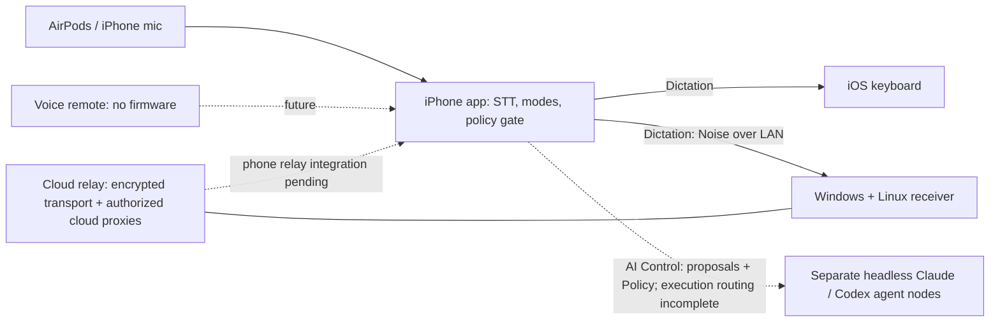

# voiceremote

Voice Control Fabric aims to put speech into the right field and direct approved agent tasks.
The app has dictation and Brain/Policy review paths; phone-to-agent execution and
the dedicated voice remote remain incomplete. Native field insertion needs device acceptance.
Dictation never presses Send. Model output never approves an action.

| Folder | What | Status |
|---|---|---|
| [SYS/](SYS/) | Product definition, design, requirements, protocol schemas | 🟡 |
| [SW/](SW/) | App/packages, desktop receiver + tray, relay, benchmark kit | 🟡 Implemented paths; device acceptance unverified |
| [FW/](FW/) | Voice remote firmware | ⬜ |
| [HW/](HW/) | Voice remote hardware | ⬜ |
| [DOCS/](DOCS/) | External references and licences of reused code | 🟡 Licence copies present |
| [AI/](AI/) | AI working files, not authoritative | 🟡 |

Start with [SYS/system-design-v1.md](SYS/system-design-v1.md). Working rules are in [AGENTS.md](AGENTS.md).

Current gaps and evidence: [requirements audit](AI/SYS/2026-11-02-requirements-audit.md).
No product milestone is fully accepted; firmware and hardware have no implementation.
