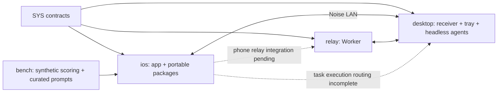

# SW: software

| Folder | What | Status |
|---|---|---|
| [ios/](ios/README.md) | App, keyboard, Live Activity, portable STT/Brain/Policy/routing packages | 🟡 Portable synthetic tests; Apple build/device acceptance unverified |
| [desktop/](desktop/README.md) | Rust receiver, native injectors, Tauri tray, exact-session headless agent adapters | 🟡 Linux tests; GUI/installers/native applications/live agents unverified |
| [relay/](relay/README.md) | Worker + Durable Objects, encrypted transport, authenticated cloud proxies | 🟡 Local runtime tests; deployment/live providers unverified |
| [bench/](bench/README.md) | Speech/brain scorer, 200 prompts, 50 commands, phone export schema | ✅ Synthetic tests; phone measurements unverified |

Start with the [requirements audit](../AI/SYS/2026-11-02-requirements-audit.md)
and [system design](../SYS/system-design-v1.md). Traces include REQ-16, REQ-22–25,
REQ-31–44 and REQ-61; implementation does not establish whole-requirement acceptance.
Run `make -C SYS check` for generated contracts and `bash SYS/tests/e2e/run.sh`
for the production Worker/Rust CLI/Swift harness with a synthetic injector.
