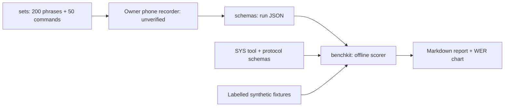

| File / folder | What | Status |
|---|---|---|
| [benchkit/](benchkit/README.md) | STT/brain scoring and `vr-bench` CLI | ✅ Synthetic tests |
| [schemas/](schemas/README.md) | Phone export and proposed gate contracts | ✅ Offline validation |
| [sets/](sets/README.md) | 200 reading prompts, vocabulary, 50 command proposals | 🟡 Owner review unverified |
| [fixtures/](fixtures/README.md) | Invented passing/failing engines; no measurements | ✅ Synthetic only |
| [tests/](tests/README.md) | Metrics, contracts, gate boundaries, CLI privacy | ✅ Synthetic tests |
| [gate.json](gate.json) | Owner-editable 25% fewer term errors; **TBC** | 🟡 Owner approval pending |
| [pyproject.toml](pyproject.toml), [uv.lock](uv.lock) | CLI entry point and pinned dependencies | ✅ uv execution |
| [.gitattributes](.gitattributes) | Audio formats tracked with Git LFS | ✅ Rules only; no audio |
| [FORMAT.md](FORMAT.md) | Recorder field definitions and scoring assumptions | ✅ Contract; recorder unverified |

Start from the repo root:

```sh
uv run --project SW/bench vr-bench report SW/bench/fixtures/synthetic-run.json
cd SW/bench && uv run pytest -q
```

The first uv invocation may download pinned dependencies; after setup use
`uv run --offline --project SW/bench vr-bench report RUN`. Scoring itself uses
local schemas only and makes no network calls.

The report shows **SYNTHETIC DATA**, a `passing-engine` PASS (66.7% fewer term errors),
a `failing-engine` FAIL (tied WER), and one Mermaid WER bar chart.
These are fixture arithmetic, never engine results. An engine qualifies only with
strictly lower corpus WER **and** strictly fewer term errors meeting `gate.json`'s
relative reduction. Override with `report RUN --config PATH`. No battery or brain
shipping threshold is invented. See [scoring details](FORMAT.md#scoring).

Owner phone steps — **unverified until the iOS recorder exists**:

1. Review [prompts and seed vocabulary](sets/README.md); replace fictional names
   only in your private copy. Keep owner transcripts, exports and reports out of git and CI logs.
2. On a named phone, record the 200 prompts once per source: iPhone mic and AirPods,
   whispering only for the whispering category. Keep position, room and gain fixed;
   note phone/OS, engine/model versions and power/thermal conditions privately.
3. Replay identical source recordings through Apple and each candidate. For each
   source/session, export [run v1](schemas/run.schema.json), including recording IDs,
   expected text, outputs and monotonic timing durations. Annotate acoustic clipping
   by listening; omitted annotation means TBD. Include failed outputs as empty text.
4. Read the 50 commands using their supplied fictional registry/context. Capture
   proposed calls and request-to-complete latency; **never execute benchmark calls**.
   Use empty calls for failures. Export in the same format (brain-only runs work).
5. If measuring battery, use a controlled interval per engine; supply elapsed seconds
   and percentage-point drain, and note background load. Missing battery stays TBD.
6. Run the report locally: `uv run --project SW/bench vr-bench report /private/run.json`.
   Review each capture source independently; do not treat a fixture PASS as permission to ship.
   Keep reports private. Owner-curated audio, if added by the owner, uses LFS only;
   check `git check-attr filter -- SW/bench/audio/example.wav` before adding it.

Purpose: Plan task 8 tooling for [REQ-13], [REQ-14], [REQ-15], [REQ-39].
Inputs: [system design](../../SYS/system-design-v1.md),
[requirements](../../SYS/requirements.md), [tool contract](../../SYS/tools/tool-call.schema.json).
Verification: synthetic arithmetic and local contracts only; real phone accuracy,
latency, clipping, battery and requirement fulfilment remain **unverified**.
