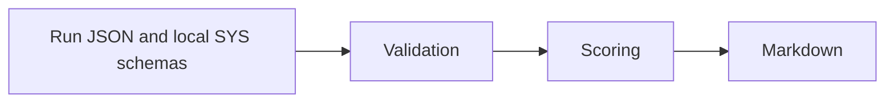

| File | What | Status |
|---|---|---|
| [__init__.py](__init__.py) | Package marker | ✅ Synthetic checks |
| [validation.py](validation.py) | Strict JSON, offline schema registry and paired coverage | ✅ Synthetic checks |
| [scoring.py](scoring.py) | Word alignment, term accuracy, timing, battery, gate | ✅ Synthetic checks |
| [cli.py](cli.py) | Report generation and CLI | ✅ Synthetic checks |

Start with the [kit README](../README.md). Purpose: benchkit for task 8.
Inputs: SYS design/tool contracts and invented text. Verification: synthetic
checks only; real phone performance and owner review **unverified**.
