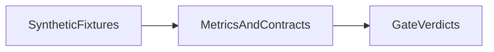

| File | What | Status |
|---|---|---|
| [test_bench.py](test_bench.py) | Synthetic metric, coverage, schema, privacy and gate tests | ✅ Synthetic checks |

Start with the [kit README](../README.md). Purpose: tests for task 8.
Inputs: SYS design/tool contracts and invented text. Verification: synthetic
checks only; real phone performance and owner review **unverified**.

Stage regressions cover paired timing arithmetic, missing field confirmation (TBD), reversed/missing start rejection, and spoken recording/transcript provenance. All inputs are synthetic; no owner audio or transcripts are logged.
