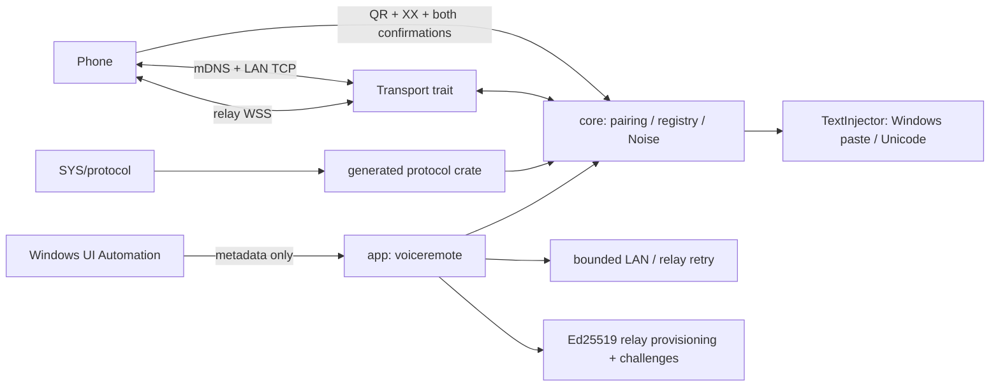

| Path | What it is | Status |
|---|---|---|
| [crates/protocol/](crates/protocol/) | Generated strict JSON wire types/codecs | ✅ |
| [Cargo.lock](Cargo.lock) | Binary workspace dependency lockfile; retained for the coordinator to commit | ✅ |
| [crates/core/](crates/core/) | Checked-DH XX, dual confirmation, signed relay auth, bounded receiver, fragments, storage and injection boundary | ✅ synthetic tests; deployed interoperability unverified |
| [crates/app/](crates/app/) | CLI `voiceremote`, headless receiver, QR renderer, Windows injection/focus wiring | ✅ synthetic tests; Windows runtime and tray pending |
| [crates/inject-windows/](crates/inject-windows/) | Windows clipboard/Unicode injection, UIA focus and owner checklist | 🟡 Linux policy tests; Windows runtime and Notepad/Chrome/Teams unverified |
| [../../SYS/protocol/noise.md](../../SYS/protocol/noise.md) | Exact suite, prologues, confirmations, words and transport profile | ✅ published synthetic vectors |
| [../../.github/workflows/desktop.yml](../../.github/workflows/desktop.yml) | Daily Ubuntu/Windows tests, `desktop-v*` tags, manual dispatch | 🟡 remote CI unverified |

Start with `core/tests/security.rs` and the [Noise profile](../../SYS/protocol/noise.md).
Trace: REQ-16, REQ-22–25, REQ-27, REQ-34, REQ-60/61. Tests prove synthetic
protocol behavior, not owner on-device acceptance or external network performance.

```sh
RUST_TEST_THREADS=4 HEAVY_CPUS=4 heavy cargo test --workspace --manifest-path SW/desktop/Cargo.toml -j4
HEAVY_CPUS=4 heavy cargo check --target x86_64-pc-windows-msvc --manifest-path SW/desktop/Cargo.toml -j4
HEAVY_CPUS=4 heavy cargo check --workspace --features os-keychain --manifest-path SW/desktop/Cargo.toml -j4
make -C SYS check
```

CLI examples (from `SW/desktop`, replace the account; LAN interface selection is automatic):

```sh
cargo run -p voiceremote-app -- pair --qr --account ACCOUNT
# Explicit operator-only bootstrap; reads VOICEREMOTE_RELAY_BOOTSTRAP_SECRET.
cargo run -p voiceremote-app -- relay-bootstrap --account ACCOUNT --room ROOM --relay https://RELAY-ORIGIN
# Phone public signing key comes from a trusted prior exchange, never the relay.
cargo run -p voiceremote-app -- pair --code --account ACCOUNT --relay https://RELAY-ORIGIN --room ROOM --phone-device PHONE --phone-relay-key PHONE_ED25519_BASE64
cargo run -p voiceremote-app -- devices
cargo run -p voiceremote-app -- revoke DEVICE_NAME_OR_FINGERPRINT
cargo run -p voiceremote-app -- run --headless --account ACCOUNT --peer PEER_KEY_FINGERPRINT
cargo run -p voiceremote-app -- dictate toggle
```

`--code` prints the complete QR JSON for transfer through a trusted channel; no
short low-entropy code or lasting credential is invented. Type the complete
four-word phrase after comparing both displays. Phone confirmation is also
mandatory. QR/token output belongs only on the local terminal; do not record it.
Relay config: `VOICEREMOTE_RELAY_URL` is an HTTPS/WSS **origin** (no path,
credentials or query), plus `VOICEREMOTE_ACCOUNT`. Ordinary operation uses a stored
Ed25519 signing key and signed challenges, **no bearer**. `relay-key --account
ACCOUNT` prints only the public key for trusted provisioning. Provisioning-secret
access is confined to the explicit `relay-bootstrap` operator command. Phone
joins using the QR token/expiry and its invited key before starting Noise.
The relay contract lacks remote discovery of that phone key; this prior trusted
exchange is required. [Exact flow and limitations](../../SYS/protocol/noise.md).

| Operational boundary | Behavior / limit |
|---|---|
| LAN exposure | Prefer a private Wi-Fi/Ethernet interface; exclude known Docker/veth/bridge/tunnel names (override with `--listen PRIVATE_IP:PORT`), ephemeral or configured TCP port, `_voiceremote._tcp.local.` discovery. No wildcard/public listener, firewall change or router mapping. Pairing retains the LAN listener while enrolled; `run` also listens while selected enrollment exists. This is the task-authorized LAN exception to design's broad “no inbound ports”. |
| Revocation | Deletes peer enrollment, retains local private identity. Every message checks disk/keychain generation; active CLI closes idle connection/listener on 250 ms polls. A phone revoke message deletes this phone's enrollment and closes transport. Add `--relay ORIGIN` (or configure the relay env var) to also sign `/revoke` and remove relay membership/queued traffic. Unknown IDs fail; names/IDs resolve uniquely. Whole-room deletion is absent from relay API; next-message rejection is tested. |
| Storage | Linux default: `$XDG_STATE_HOME/voiceremote` or `$HOME/.local/state/voiceremote`. Override with `--state-dir` / `VOICEREMOTE_STATE_DIR`; never put it in the repository. File fallback rejects symlinks and broad permissions: directories 0700, files 0600; atomic replacement + fsync. No automatic insecure fallback from keychain. |
| OS keychain | Build `--features os-keychain`, select `--keychain`. `keyring` uses Linux kernel keyring (`linux-native`) / Windows Credential Manager (`windows-native`). Live OS keychain behavior is **unverified**; Linux kernel keys follow login/session lifetime, so use file fallback for durable headless service storage. Windows refuses file fallback; keychain feature required there. |
| Local identity | Pairing persists local device/account identity. `run` defaults to it; a conflicting `--device` fails before opening a listener. Use a separate state directory for a separate account/device. |
| Receiver lifetime | Four concurrent LAN connections; admission 10 seconds; per-connection failures and filtered peers are non-fatal. TCP keepalive 10 s / 5 s interval; WS ping 10 s / missing traffic/pong 30 s; authenticated application idle timeout 90 s. Shutdown/revocation cancels pending handshakes and offline retries. Relay waits indefinitely for a phone on a healthy socket and reconnects with 500 ms–30 s bounded backoff. |
| Concurrency | One receiver lease per state directory; reuse the same state directory for every instance using the same keychain service. Embedders take `ReceiverLease` too. File journal claims are atomic across handles; keychain claims serialize within the leased process. Revocation/devices remain available from a second process. |
| Idempotency | Durable, separate command and committed-segment namespaces. Reserve before dispatch/injection, never evict. A crash or injection failure after reservation is at-most-once: delivery may be lost and needs explicit reconciliation. Journal disk growth is unbounded; quota/retention policy **TBD**. |
| Dictation | Large JSON is split into independently encrypted packets ≤11,000 bytes; strict ordered reassembly precedes validation/injection. Maximum legal Unicode dictation fits the worker’s 16,384-byte frame cap. Malformed/interleaved fragments fail closed. Only validated committed text addressed to this desktop reaches `TextInjector`. C0/C1 controls and line/paragraph separators rejected; partial/stale/duplicate segments do not insert. Windows uses private clipboard paste with restoration, Unicode fallback, UIA password/read-only denial and UIPI checks. Linux remains unavailable until its platform worker attaches it. No text logged. |
| Windows focus | Windows app session adapter sends encrypted focus boolean + last input time every second; no field values or titles. Its transport keeps partial LAN frames and relay heartbeat timers across focus polls. The core transport/supervisor APIs remain unchanged; adapters are Windows-only except synthetic Linux tests. Native behavior and phone UI remain **unverified**; see [manual checks](crates/inject-windows/manual-test.md). |
| Commands | Schema approval invariants enforced and idempotency reserved; no execution queue or provider invocation exists. Trusted policy/preview/scope validation is P1, not inferred from model fields. `Target` and `AgentAdapter` are empty extension traits. |
| Relay gaps | The 32,768-byte offline queue cannot buffer the entire largest Unicode dictation; online fragmentation is tested, offline delivery of that size is not guaranteed. No anonymous first-pair key discovery, whole-room deletion or end-to-end fragment delivery acknowledgement is defined. Failed Noise pairing best-effort revokes the invited phone membership so a fresh invitation can be issued. |
| Timing / deployment | Compute pairing under one minute tested over loopback TCP and fake relay. Human time, home/external network, physical iPhone, mDNS on actual LAN, live TLS and Windows runtime **unverified**. |
| UI | `dictate toggle` explicitly reports a stub. `tray` feature reserved; no Tauri dependency. |
