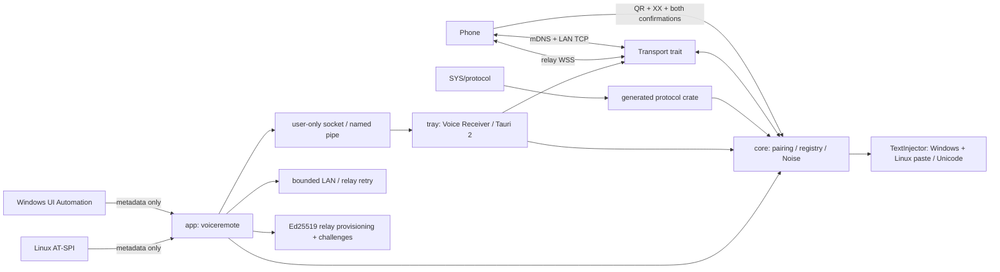
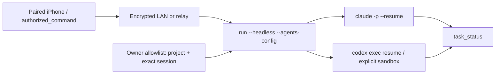

| Path | What it is | Status |
|---|---|---|
| [crates/protocol/](crates/protocol/) | Generated strict JSON wire types/codecs | ✅ |
| [Cargo.lock](Cargo.lock) | Binary workspace dependency lockfile; retained for the coordinator to commit | ✅ |
| [crates/core/](crates/core/) | Checked-DH XX, dual confirmation, signed relay auth, bounded receiver, fragments, storage and injection boundary | ✅ synthetic tests; deployed interoperability unverified |
| [crates/tray/](crates/tray/) | Tauri 2 tray, rotating QR, dual phrase confirmation, roles/devices/revoke, autostart and fixed event log | 🟡 plain logic tested; native GUI/installer/phone unverified |
| [crates/app/](crates/app/) | CLI `voiceremote`, headless receiver, QR renderer, Windows/Linux injection and shared focus wiring | ✅ synthetic tests; Windows runtime unverified; local toggle transport implemented |
| [crates/inject-linux/](crates/inject-linux/) | X11 XTest / persistent Wayland portal/EIS; bounded clipboard restore and conservative focus | 🟡 synthetic tests; Xvfb CI and GNOME runtime unverified |
| [crates/inject-windows/](crates/inject-windows/) | Windows clipboard/Unicode injection, UIA focus and owner checklist | 🟡 Linux policy tests; Windows runtime and Notepad/Chrome/Teams unverified |
| [../../SYS/protocol/noise.md](../../SYS/protocol/noise.md) | Exact suite, prologues, confirmations, words and transport profile | ✅ published synthetic vectors |
| [../../.github/workflows/desktop.yml](../../.github/workflows/desktop.yml) | Daily Ubuntu/Windows tests and native tray installers, draft releases on guarded `desktop-v*` tags | 🟡 remote CI unverified |

Start with `core/tests/security.rs` and the [Noise profile](../../SYS/protocol/noise.md).
Trace: REQ-16, REQ-22–25, REQ-27, REQ-34, REQ-60/61. Tests prove synthetic
protocol behavior, not owner on-device acceptance or external network performance.

```sh
RUST_TEST_THREADS=4 HEAVY_CPUS=4 heavy cargo test --workspace --locked --manifest-path SW/desktop/Cargo.toml -j4
HEAVY_CPUS=4 heavy cargo check --locked --target x86_64-pc-windows-msvc --manifest-path SW/desktop/Cargo.toml -j4
HEAVY_CPUS=4 heavy cargo check --locked --workspace --features os-keychain --manifest-path SW/desktop/Cargo.toml -j4
make -C SYS check
```

CLI examples (from `SW/desktop`, replace the account; LAN interface selection is automatic):

```sh
cargo run -p voiceremote-app -- pair --qr --account ACCOUNT
# Explicit operator-only bootstrap; reads VOICEREMOTE_RELAY_BOOTSTRAP_SECRET.
cargo run -p voiceremote-app -- relay-bootstrap --account ACCOUNT --room ROOM --relay https://RELAY-ORIGIN
# Fresh signed room/invite; phone chooses its own relay key when redeeming QR.
cargo run -p voiceremote-app -- pair --code --account ACCOUNT --relay https://RELAY-ORIGIN
# Existing room membership: add --room ROOM. Optional --phone-device asserts DeviceInfo.
cargo run -p voiceremote-app -- devices
cargo run -p voiceremote-app -- revoke DEVICE_NAME_OR_FINGERPRINT
cargo run -p voiceremote-app -- run --headless --account ACCOUNT --peer PEER_KEY_FINGERPRINT
cargo run -p voiceremote-app -- dictate toggle
```

`--code` prints the complete QR JSON for transfer through a trusted channel; no
short low-entropy code or lasting credential is invented. Type the complete
four-word phrase after comparing both displays. Phone confirmation is also
mandatory. QR/token output belongs only on the local terminal; do not record it.
Relay config: `VOICEREMOTE_RELAY_URL` is an HTTPS/WSS **origin** (no path,
credentials or query), plus `VOICEREMOTE_ACCOUNT`. Ordinary operation uses a stored
Ed25519 signing key and signed challenges, **no bearer**. `relay-key --account
ACCOUNT` prints only the public key for trusted provisioning. Provisioning-secret
is optional for deployments requiring it: `relay-bootstrap` or signed fresh-room
creation can supply it from `VOICEREMOTE_RELAY_BOOTSTRAP_SECRET`. Phone joins with
the QR token/expiry and its own newly generated Ed25519 key before Noise.
No trusted prior phone-key exchange is required. [Exact flow and limitations](../../SYS/protocol/noise.md).

| Operational boundary | Behavior / limit |
|---|---|
| LAN exposure | Prefer a private Wi-Fi/Ethernet interface; exclude known Docker/veth/bridge/tunnel names (override with `--listen PRIVATE_IP:PORT`), ephemeral or configured TCP port, `_voiceremote._tcp.local.` discovery. No wildcard/public listener, firewall change or router mapping. Pairing retains the LAN listener while enrolled; `run` also listens while selected enrollment exists. This is the task-authorized LAN exception to design's broad “no inbound ports”. |
| Revocation | Deletes peer enrollment, retains local private identity. Every message checks disk/keychain generation; active CLI closes idle connection/listener on 250 ms polls. A phone revoke message deletes this phone's enrollment and closes transport. Add `--relay ORIGIN` (or configure the relay env var) to also sign `/revoke` and remove relay membership/queued traffic. Unknown IDs fail; names/IDs resolve uniquely. Whole-room deletion is absent from relay API; next-message rejection is tested. |
| Storage | Linux default: `$XDG_STATE_HOME/voiceremote` or `$HOME/.local/state/voiceremote`. Override with `--state-dir` / `VOICEREMOTE_STATE_DIR`; never put it in the repository. File fallback rejects symlinks and broad permissions: directories 0700, files 0600; atomic replacement + fsync. No automatic insecure fallback from keychain. |
| OS keychain | Build `--features os-keychain`, select `--keychain`. `keyring` uses Linux kernel keyring (`linux-native`) / Windows Credential Manager (`windows-native`). Live OS keychain behavior is **unverified**; Linux kernel keys follow login/session lifetime, so use file fallback for durable headless service storage. Windows refuses file fallback; keychain feature required there. |
| Local identity | Pairing persists local device/account identity. `run` defaults to it; a conflicting `--device` fails before opening a listener. Use a separate state directory for a separate account/device. |
| Receiver lifetime | Four concurrent LAN connections; admission 10 seconds; per-connection failures and filtered peers are non-fatal. TCP keepalive 10 s / 5 s interval; WS ping 10 s / missing traffic/pong 30 s; authenticated application idle timeout 90 s. Shutdown/revocation cancels pending handshakes and offline retries. Relay waits indefinitely for a phone on a healthy socket and reconnects with 500 ms–30 s bounded backoff. |
| Concurrency | One receiver lease per state directory; reuse the same state directory for every instance using the same keychain service. Embedders take `ReceiverLease` too. File journal claims are atomic across handles; keychain claims serialize within the leased process. Revocation/devices remain available from a second process. |
| Idempotency | Durable, separate command and committed-segment namespaces. Reserve before dispatch/injection, never evict. Certified pre-input failure releases the segment claim for retry. Uncertain/partial delivery or a crash retains its claim for reconciliation; replay reports uncertainty, never false success. Failure TaskStatus uses segment_id as command_id; unavailable means retryable, error means uncertain. Journal disk growth is unbounded; quota/retention policy **TBD**. |
| Dictation | Large JSON is split into independently encrypted packets ≤11,000 bytes; strict ordered reassembly precedes validation/injection. Maximum legal Unicode dictation fits the worker’s 16,384-byte frame cap. Malformed/interleaved fragments fail closed. Only validated committed text addressed to this desktop reaches `TextInjector`. C0/C1 controls and line/paragraph separators rejected; partial/stale/duplicate segments do not insert. Windows uses private clipboard paste (unconfirmed and retained after a queued chord), pre-chord restoration, Unicode fallback, UIA password/read-only denial and UIPI checks. Linux desktop mode uses inject-linux; headless mode needs no injector on either OS. Linux paste waits up to 30 seconds and restores the previous clipboard if still owned; delivery is reported unconfirmed, with no automatic retry. No text logged. |
| Desktop focus | Shared Windows/Linux app session adapter sends encrypted focus boolean + last input time on change with a 30-second heartbeat (sampled each second); no field values or titles. Its transport keeps partial LAN frames and relay heartbeat timers across focus polls. Both platforms share the core VRR1 relay codec, freshness filters and persistent keepalive; LAN framing retains partial reads. One driver samples platform metadata; unknown focus reports false. Native behavior and phone UI remain **unverified**; see [manual checks](crates/inject-windows/manual-test.md). |
| Commands | Default receiver reserves commands without execution. Opt-in headless `--agents-config` attaches exact-session CLI adapters through paired Noise; see [agent nodes](#agent-nodes) for authority, lifetime and cancellation limits. Core `AgentAdapter` remains a marker extension trait. |
| Relay gaps | The 2,105,344-byte offline queue is bounded; whole-room deletion and end-to-end fragment acknowledgement are absent. First pairing uses QR redemption with the phone’s own signing key. Failed Noise pairing best-effort revokes the invited phone membership so a fresh invitation can be issued. |
| Timing / deployment | Compute pairing under one minute tested over loopback TCP and fake relay. Human time, home/external network, physical iPhone, mDNS on actual LAN, live TLS and Windows runtime **unverified**. |
| UI | Optional `crates/tray` Tauri 2 shell; `dictate toggle` sends a user-only local capture request. The app crate’s `tray` feature suppresses its Windows console for installed hotkeys; ordinary headless builds have no GUI dependency. Native acceptance remains unverified. |

## Agent nodes



| Path | What | Status |
|---|---|---|
| [crates/agents/](crates/agents/README.md) | REQ-34/41/44: exact-session adapters + private durable replay claims | ✅ synthetic Linux Noise/fake CLI tests; live providers unverified |
| [User unit](crates/agents/systemd/voiceremote-agent.service) | Optional systemd template | 🟡 not installed |

Pair the host with the phone first using the existing `pair` command. Authenticate
installed Claude Code and Codex CLIs as that same Unix user through their own
supported login flow. The adapter reads no auth files and forwards no API keys.
Keep the allowlist outside the repository, owner-controlled (no group/other write).
`host` must equal the paired receiver's device ID, and `phone_device` its paired
iOS device ID. Use exact provider IDs from the owner's known sessions:

```toml
account = "ACCOUNT"
host = "hwgeekom"
phone_device = "PHONE_DEVICE_ID"
actor = "OWNER_ACTOR_ID"
max_command_age_ms = 30000
# Owner-selected resource limits, not benchmark measurements.
timeout_ms = 120000
max_output_bytes = 1048576

[[projects]]
project = "arm-design"
workspace = "/absolute/owner/project"
provider = "claude" # claude | codex | cloud
account = "ACCOUNT"
host = "hwgeekom"
capability_profile = "read-only" # safest default if omitted; workspace-write enables edits
sessions = ["EXACT_PROVIDER_SESSION_ID"]
# Optional owner-exported metadata file, outside all agent workspaces:
# discovery_file = "/absolute/owner/config/arm-sessions.toml"
```

Cloud tasks use a **separate** allowlisted project entry. They never continue the
local session. Disabled by default; the owner explicitly enables a provider and its
repository environment, with existing CLI login. Example (replace placeholders):

```toml
[[projects]]
project = "cloud-research"
capability_profile = "workspace-write" # cloud environment permissions apply
workspace = "/absolute/owner/repository"
provider = "cloud"
account = "ACCOUNT"
host = "hwgeekom"
sessions = ["new-cloud-task"] # routing selector only; never passed as a session ID
[projects.cloud]
enabled = true # omitted/false disables cloud execution
# For a read-only route only: allow_read_only_override = true explicitly permits
# provider-environment permissions; the receipt labels that override.
provider = "codex" # codex | claude
# Codex environment ID, or Claude self-hosted ccpool_… environment ID:
environment = "OWNER_ENVIRONMENT_ID"
repository = "https://github.com/OWNER/REPOSITORY.git"
branch = "OWNER_BRANCH"
```

Origin and checked-out branch must match exactly. Provider environment permissions
apply remotely. Claude may upload repository history/tracked changes if its GitHub
app cannot clone it; enable only for a repository approved for that behavior.
Local cloud receipts carry the provider task ID/status, `cloud` label, no local
session continuity, and explicit unsupported cancellation. Submission never reports
task completion. The existing wire status lacks label/task-ID fields; phone display
and settings are a later task. Windows computer-use actions are explicitly
unsupported. [CLI findings and boundaries](crates/agents/README.md) record installed
versions and official sources; live owner-account behavior remains **unverified**.

Each discovery entry has `[[sessions]]`, `provider_session_id`, and an absolute
`workspace` equal to this project's allowed directory. Unknown projects/sessions,
missing session IDs and cross-workspace entries reject. There is no latest-session
selection, provider fallback or home-directory transcript crawl.

```sh
cargo run -p voiceremote-app -- run --headless --account ACCOUNT --peer PEER_FINGERPRINT --agents-config /absolute/owner/agents.toml
HEAVY_CPUS=4 heavy cargo test -p voiceremote-agents --manifest-path SW/desktop/Cargo.toml -j4
```

Delegation requires phone-authenticated sensitive approval. Lifetime is bounded
from `created_at` because the current wire schema lacks exact expiry/preview bytes.
Cancel/revoke is read concurrently on the same paired LAN or relay connection.
Three execution slots reserve LAN capacity for controls. Per-task systemd user
scopes confirm tree cleanup; without a bus or confirmed cleanup, status remains
`running/unavailable` (unconfirmed), never cancelled. Retries return durable running
or terminal receipts. Live cgroups/providers and exact phone expiry remain
**unverified**; Windows execution refuses before spawning. See the complete
[operational boundaries](crates/agents/README.md).

Optional user-service setup (instructions only; none performed): place the built
binary at `~/.local/bin/voiceremote`, copy the unit to
`~/.config/systemd/user/voiceremote-agent.service`, and create private
`~/.config/voiceremote/agents.toml` plus `agent.env` containing only
`VOICEREMOTE_ACCOUNT=...` and `VOICEREMOTE_PHONE=...` (peer fingerprint).
Review the unit's PATH for installed CLIs, then run `systemctl --user daemon-reload`
and `systemctl --user enable --now voiceremote-agent`. The service and task scopes
default to `MemoryMax=2G`, `CPUQuota=100%` (**TBC**). Logs contain no transcripts;
provider CLI storage follows the provider's own retention policy. Service deployment
and permission-setting behavior on the owner machine are **unverified**.
[Actual local E2E](../../SYS/tests/e2e/README.md): `bash SYS/tests/e2e/run.sh` verifies the production Worker, real CLI and Swift phone over WS/TCP using the fixed synthetic injector feature.


### Install and use Voice Receiver (unverified until desktop CI acceptance)

Download the Windows NSIS `.exe` or Linux `.deb` / `.AppImage` from the
coordinator’s draft GitHub Release (`desktop-v0.1.0`). Install with the desktop
installer/package manager, launch **Voice Receiver**, and choose **Pair a phone**.
Enter the account ID shown on your phone and a stable computer name. On local
Wi-Fi, leave Relay blank; remote networks need your deployment’s relay origin.
The installer includes `voiceremote` beside the GUI (deb: `/usr/bin`; Windows:
per-user application install directory). Point OS hotkey tools at that executable
with arguments `dictate toggle`; the tray receiver must be running. The bundled
Windows hotkey helper suppresses its console to avoid taking input focus. The AppImage
contains the CLI inside its image; prefer the deb for a stable hotkey path.
Scan the QR, compare the four words on both displays, enter them here, and also
confirm on the phone. Choose Text receiver, Agent or Both. Agent execution still
requires the separately configured headless node; choosing a role grants no tools.
Use **Revoke** beside an enrolled device to remove trust immediately. Close hides
the window; **Quit Voice Receiver** in the tray stops it. Autostart is opt-in and
uses the installed executable. Linux needs a desktop with an AppIndicator tray
host (GNOME may need an extension); AppImage systems also need FUSE support.
The deb requires normal package-manager authorization, without a terminal.

The tray shows D/A for Dictation/AI Control plus a listening dot; unknown/offline
phone state is shown explicitly. A brief flash and a click-through, nonfocusable
overlay announce incoming text addressed to this computer. Destination is the last
observed target here, not the phone’s entire target picker. `tray.log` in the state
directory contains bounded fixed event names and timestamps, never text, keys,
QR payloads, device names or errors. State defaults are shared with the CLI. Windows GUI builds use the existing OS
keychain adapter; Linux uses the core’s private file store.

| Boundary | Implementation / evidence |
|---|---|
| Build separation | `crates/tray` excluded from `default-members`; default library has no Tauri dependency. `cargo test --workspace` still runs plain tray tests. `gui` is explicit and native GUI builds run only in CI. |
| Local hotkey | `voiceremote dictate toggle`: fixed bounded socket/pipe request, no TCP. Unix 0700 directory + 0600 socket + peer UID on both ends. Windows protected current-SID DACL, remote clients rejected, server SID checked. Exactly one live phone session and reported capture state required. |
| Phone toggle | Sends the existing encrypted `CaptureStateReport` addressed to the phone with desired Off/Continuous. Success means sent, not accepted. No toggle-request schema or phone handler exists in this scope; actual capture transition is **unverified** and requires phone integration. |
| QR rotation / short code | Core one-use two-minute QR rotates on expiry. The QR is removed at phrase confirmation. Eight hexadecimal characters are a display reference derived from the QR, **not an enrollment credential**. Camera-free redemption has no current protocol and remains **unimplemented**. |
| Auto announcement | Current schema carries no explicit target-selection event. Flash is triggered by authenticated text addressed here; strict Auto-before-first-word timing is **unverified**. |
| Windows signing | CI imports base64 PFX `WINDOWS_CERT` only when supplied, with `WINDOWS_CERT_PASSWORD`. Otherwise installers are unsigned and Windows SmartScreen may warn or block launch. Signing does not establish SmartScreen reputation. See [Tauri signing](https://v2.tauri.app/distribute/sign/windows/). |
| Licensing | Original UI + Tauri 2 (MIT OR Apache-2.0); CI rejects GPL-only Cargo packages. Linux dynamically links GTK/WebKit and AppIndicator under their native LGPL terms; no GPL application code was reused. |
| Release guard | Tag must equal `desktop-v` + workspace `Cargo.toml` version; Tauri config must match; release commit must be accepted on `origin/main`. Builds use `--locked`. Windows NSIS + Ubuntu 22.04 deb/AppImage attach to a **draft** release; `desktop-ci-*` keeps installers as workflow artifacts. |

**Unverified:** coordinator’s `desktop-ci-*` native Windows/Linux run, installation,
tray visibility, autostart, overlay focus on real desktops, Windows cross-user pipe
access, phone state/toggle handling, LAN/external-network pairing and remote relay
cleanup. Unit tests are synthetic evidence only (REQ-18/21–25/57).

The workspace lockfile includes the tray dependency graph. Local checks and CI
use `--locked`; native GUI/installer acceptance remains **unverified**.
