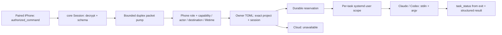

| Path | What | Status |
|---|---|---|
| [src/](src/README.md) | Allowlist, adapters, authenticated receiver | ✅ synthetic Noise + fake CLI tests |
| [tests/](tests/README.md) | Routing, argv, replay, authorization, limits, tree cancellation | ✅ Linux |
| [systemd/](systemd/README.md) | User service template; nothing installed | 🟡 owner deployment unverified |
| [Cargo.toml](Cargo.toml) | Core marker trait implementation; no schema changes | ✅ Linux tests / Windows compile checked separately |

Start with [desktop setup](../../README.md#agent-nodes). REQ-34/41/44/60.
The CLI credentials and project settings belong to the service user. No auth files
are read by the adapter, and no transcript/provider output enters diagnostics.
Only exact session IDs are resumed; no latest-session, fallback or new-session heuristic.

| Boundary | Behavior / limit |
|---|---|
| Authority | `receiver::serve` accepts core's paired Noise `Session`; there is no public raw-command dispatch API. Every command checks current enrollment, unambiguous configured iOS phone/actor/account/host, paired capture/control role and the exact delegate/cancel capability, schema, state and timestamp. Delegation keeps Policy's sensitive-risk floor: phone passcode/biometric approval event required. Model output never becomes a command. |
| Expiry assumption | Wire `AuthorizedCommand` lacks an expiry or retained-preview field. Locally accept only `created_at <= now < created_at + max_command_age_ms`, capped at 30,000 ms. Phone remains responsible for its exact preview/grant/expiry checks immediately before forwarding. Exact phone expiry interoperability is **unverified** until the schema carries that deadline; no preview is reserialized or claimed verified here. |
| Status | Terminal `task_status` reflects process exit AND matching provider session/structured success. Nonzero, malformed output, provider error, cancellation, timeout and pipe limits cannot report success. `ProcessResult` retains exit code/signal locally; the wire schema carries only outcome, not that detail or response text. A bounded `AgentNode::recent_results()` ring retains local exit metadata without prompt/output. No result payload/schema extension is invented. |
| Replay | Private durable storage claims both phone key and command ID before invocation and stores running/terminal `task_status` plus exit metadata, without payload/output. Retries return that receipt, including after restart or command expiry; they never invent a terminal failure for a running/succeeded task. A claim without a receipt is `running/unavailable` (delivery unknown), never re-executed. Tombstones/metadata remain; crash after claim can lose delivery. |
| Cancellation | LAN and relay continuously receive controls while tasks execute, including cancel/revoke on the **same** Noise connection. Three execution slots leave a fourth LAN connection for controls. The request acknowledgement is separate from the target outcome. Only confirmed scope cleanup can produce target `cancelled`. Without a user bus, or if cleanup cannot be confirmed, the target stays `running/unavailable`; local `Finish::Unconfirmed` and scope name support reconciliation. Existing Router accepts this nonterminal status; no iOS edit is needed. |
| Disconnect | Socket EOF, service stop and revocation request cleanup, await bounded scope control and preserve durable results. A crash/drop leaves an uncertain running receipt. Scope `RuntimeMaxSec` provides an independent maximum lifetime; live systemd behavior is **unverified** here. |
| Processes | Unique `systemd-run --user --scope` per task; `systemctl --user kill --kill-whom=all --signal=KILL` and `stop` clean up descendants even after `setsid`/`setpgid`. Confirmation requires an inactive/failed unit with zero tasks, or an unloaded unit. A process group remains only a best-effort fallback; interrupted fallback work is **unconfirmed**, never cancelled. Tests use fake systemd controls and a real `setsid` fake child; live cgroups remain **unverified**. Windows execution refuses before spawn. |
| Permissions | Default profile is `read-only`. Claude uses `--restricted`, `--strict-mcp-config` (no supplied servers), disabled slash commands and inline `disableAllHooks=true`. Read-only exposes Read/Glob/Grep; workspace-write adds Edit/Write, **never Bash/code-running tools**. Restricted mode confines built-in file tools to working directories and ignores ordinary user/project/local settings; it refuses bypass permissions. These are CLI restrictions, not an OS filesystem sandbox. Managed hooks/policy/forced plugins may still apply: an owner must audit managed policy. Codex gets `exec -s read-only|workspace-write resume ...`, so the exec-level sandbox precedes resume; no dangerous bypass. |
| Resources / privacy | Default CLI deadline 120,000 ms; output cap 1 MiB per stream; owner-configurable bounds. Stdin writes and drains share the deadline. Bus probes/cleanup have separate bounded timeouts. Per-task scopes and service template set `MemoryMax=2G`, `CPUQuota=100%` (**TBC**, defensive defaults, not benchmark claims). Environment includes PATH, home/system/temp/locale paths and user-bus address/runtime paths needed by systemd; no API keys, relay secrets, SSH agent, proxy or loader variables. CLI storage follows provider policy. |
| Discovery | Owner-listed session IDs and optional owner-controlled metadata export only; no global home-directory crawl or transcript inspection. Exported sessions must resolve to the exact allowed workspace. Allowlist and metadata files must live outside every agent workspace, so workspace edits cannot add session authority. Native provider session enumeration/active-session locking and live provider continuity are **unverified**. |

Implementation checked against local `claude --help`, `codex --help`, `codex exec
--help`, `codex exec resume --help` and current official documentation:
[Claude headless](https://code.claude.com/docs/en/headless),
[Claude CLI](https://code.claude.com/docs/en/cli-reference),
[hook setting and managed exceptions](https://code.claude.com/docs/en/settings-reference#disableallhooks),
[systemd scope lifecycle](https://www.freedesktop.org/software/systemd/man/latest/systemd.scope.html),
[Codex non-interactive](https://developers.openai.com/codex/noninteractive/),
[Codex CLI](https://developers.openai.com/codex/cli/reference/).
Codex JSONL `error` warnings may recover: success requires the matching thread, a completed turn and exit zero; `turn.failed`, missing completion, malformed events and nonzero exits fail.

Real CLIs are **unverified**: the opt-in `process::tests::live_cli_smoke_opt_in`
returns immediately unless `VOICEREMOTE_LIVE_AGENT_SMOKE=1`; it then requires
`VOICEREMOTE_LIVE_AGENT_CONFIG` pointing to an owner allowlist with existing
Claude **and** Codex sessions. It is never enabled by normal CI/test commands.
