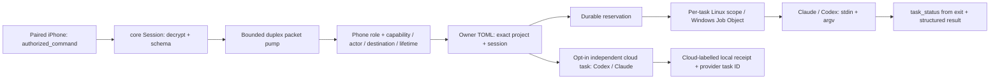

| Path | What | Status |
|---|---|---|
| [src/](src/README.md) | Allowlist, adapters, authenticated receiver | ✅ synthetic Noise + fake CLI tests |
| [tests/](tests/README.md) | Routing, argv, replay, authorization, limits, tree cancellation | ✅ Linux |
| [systemd/](systemd/README.md) | User service template; nothing installed | 🟡 owner deployment unverified |
| [Cargo.toml](Cargo.toml) | Core marker trait implementation; no schema changes | ✅ Linux tests / Windows compile checked separately |

Start with [desktop setup](../../README.md#agent-nodes). REQ-34/41/44/60.
The CLI credentials and project settings belong to the service user. No auth files
are read by the adapter, and no transcript/provider output enters diagnostics.
Local providers resume only exact session IDs. Cloud routes create independent tasks;
the owner-listed `sessions` value is a route selector and is never sent to a cloud CLI.
There is no automatic fallback or claim that cloud work continues a local session.

| Boundary | Behavior / limit |
|---|---|
| Authority | `receiver::serve` accepts core's paired Noise `Session`; there is no public raw-command dispatch API. Every command checks current enrollment, unambiguous configured iOS phone/actor/account/host, paired capture/control role and the exact delegate/cancel capability, schema, state and timestamp. Delegation keeps Policy's sensitive-risk floor: phone passcode/biometric approval event required. Model output never becomes a command. |
| Expiry / exact identity | App sends `AgentDispatch`: exact authenticated inventory session, retained preview bytes and original expiry. Node verifies SHA-256 over retained bytes and preview/tool/account/actor/device/project/risk/request/policy/expiry bindings before admission, then applies its command-age cap. Legacy `authorized_command` delegation retains the local age check. Existing receipts precede expiry checks; retries never re-execute. |
| Status | For local providers, terminal `task_status` reflects process exit AND matching provider session/structured success. Nonzero, malformed output, provider error, cancellation, timeout and pipe limits cannot report success. `ProcessResult` retains exit code/signal locally; the wire schema carries only outcome, not that detail or response text. A bounded `AgentNode::recent_results()` ring retains local exit metadata without prompt/output. No result payload/schema extension is invented. |
| Cloud | Off without a per-project `[projects.cloud]` table and `enabled=true`. Exact configured origin/branch must match the workspace before launch. Codex submits `cloud exec --env … --branch … --attempts 1 -`; Claude submits `--cloud --environment … -p`. Both use stdin, the existing scrubbed environment, bounded pipes/deadline and local tree cleanup. A read-only capability profile refuses cloud execution unless `allow_read_only_override=true` is explicitly set in this project’s cloud table. Override receipts say `read-only override: provider environment permissions`; no cloud read-only guarantee is made. Workspace-write receipts say `provider environment permissions`. |
| Cloud receipts | Every cloud process receipt includes `label=cloud`, provider, optional real task ID, status, `continues_local_session=false`, `cancellation_supported=false`. Codex gets one bounded status snapshot; Claude reports submitted (no supported cloud-status command established). Submission, ready/applied output, unknown output and timeout never prove delegated-task success. Wire `task_status` remains running/unavailable after submission; local receipts retain details. Cloud compatibility is selected by the authenticated caller/owner route; no local-file/UI task is automatically redirected. No background polling or wire label/task-ID field exists; phone display/settings integration remains **unverified** and out of scope. Retries reuse receipts, never resubmit. |
| Cloud cancellation | Installed CLIs expose no cloud cancellation command. Explicit cancel returns `CancelUnsupported` with the original cloud receipt, including after restart. Launch-time receipts are `Unknown`, because submission may already have happened; cancel signals an active local launcher and reports remote cancellation unsupported. A restarted node retains uncertainty and cannot signal a launcher it no longer owns. Disconnect/revoke stops the local launcher only; a remote task may already exist and keep running. Timeout/malformed success remains unknown, never claims remote cancellation or invents an ID. Slots are released after handoff; owner reconciles cloud tasks through the provider. |
| Computer use | Phone delegates the exact instruction, or an approved HTTPS open-resource request, to the owner-selected installed Claude/Codex CLI session. No GUI input driver. Deep links prefill composers; they do not provide command completion/cancel. Unsupported provider tools fail honestly under that CLI’s permissions. See supported entry points below. |
| Replay | Private durable storage claims both phone key and command ID before invocation and stores running/terminal `task_status` plus exit metadata, without payload/output. Retries return that receipt, including after restart or command expiry; they never invent a terminal failure for a running/succeeded task. A claim without a receipt is `running/unavailable` (delivery unknown), never re-executed. Tombstones/metadata remain; crash after claim can lose delivery. |
| Cancellation | LAN and relay continuously receive controls while tasks execute, including cancel/revoke on the **same** Noise connection. Three execution slots leave a fourth LAN connection for controls. The request acknowledgement is separate from the target outcome. Only confirmed scope cleanup can produce target `cancelled`. Without a user bus, or if cleanup cannot be confirmed, the target stays `running/unavailable`; local `Finish::Unconfirmed` and scope name support reconciliation. Existing Router accepts this nonterminal status; no iOS edit is needed. |
| Disconnect | Socket EOF, service stop and revocation request cleanup, await bounded scope control and preserve durable results. A crash/drop leaves an uncertain running receipt. Scope `RuntimeMaxSec` provides an independent maximum lifetime; live systemd behavior is **unverified** here. |
| Processes | Unique `systemd-run --user --scope` per task; `systemctl --user kill --kill-whom=all --signal=KILL` and `stop` clean up descendants even after `setsid`/`setpgid`. Confirmation requires an inactive/failed unit with zero tasks, or an unloaded unit. A process group remains only a best-effort fallback; interrupted fallback work is **unconfirmed**, never cancelled. Tests use fake systemd controls and a real `setsid` fake child; live cgroups remain **unverified**. Windows starts suspended, assigns the child to a non-breakaway Job Object with kill-on-close, then resumes its initial thread. Cleanup reports confirmed only after `ActiveProcesses == 0`; assignment/resume failure kills the suspended child before it runs. Windows runtime behavior remains **unverified**; cross-compilation is not HIL. |
| Permissions | Default profile is `read-only`. Claude uses `--restricted`, `--strict-mcp-config` (no supplied servers), disabled slash commands and inline `disableAllHooks=true`. Read-only exposes Read/Glob/Grep; workspace-write adds Edit/Write, **never Bash/code-running tools**. Restricted mode confines built-in file tools to working directories and ignores ordinary user/project/local settings; it refuses bypass permissions. These are CLI restrictions, not an OS filesystem sandbox. Managed hooks/policy/forced plugins may still apply: an owner must audit managed policy. Codex gets `exec -s read-only|workspace-write resume ...`, so the exec-level sandbox precedes resume; no dangerous bypass. |
| Resources / privacy | Default CLI deadline 120,000 ms; output cap 1 MiB per stream; owner-configurable bounds. Stdin writes and drains share the deadline. Bus probes/cleanup have separate bounded timeouts. Per-task scopes and service template set `MemoryMax=2G`, `CPUQuota=100%` (**TBC**, defensive defaults, not benchmark claims). Environment includes PATH, home/system/temp/locale paths and user-bus address/runtime paths needed by systemd; no API keys, relay secrets, SSH agent, proxy or loader variables. CLI storage follows provider policy. |
| Discovery | Owner-listed session IDs and optional owner-controlled metadata export only; no global home-directory crawl or transcript inspection. Exported sessions must resolve to the exact allowed workspace. Allowlist and metadata files must live outside every agent workspace, so workspace edits cannot add session authority. Native provider session enumeration/active-session locking and live provider continuity are **unverified**. |

Implementation checked against local `claude --help`, `codex --help`, `codex exec
--help`, `codex exec resume --help` and current official documentation:
[Claude headless](https://code.claude.com/docs/en/headless),
[Claude CLI](https://code.claude.com/docs/en/cli-reference),
[hook setting and managed exceptions](https://code.claude.com/docs/en/settings-reference#disableallhooks),
[systemd scope lifecycle](https://www.freedesktop.org/software/systemd/man/latest/systemd.scope.html),
[Codex non-interactive](https://developers.openai.com/codex/noninteractive/),
[Codex CLI](https://developers.openai.com/codex/cli/reference/).
Codex JSONL `error` warnings may recover: success requires the matching thread, a completed turn and exit zero; `turn.failed`, missing completion, malformed events and nonzero exits fail.

Real CLIs are **unverified**: the opt-in `process::tests::live_cli_smoke_opt_in`
returns immediately unless `VOICEREMOTE_LIVE_AGENT_SMOKE=1`; it then requires
`VOICEREMOTE_LIVE_AGENT_CONFIG` pointing to an owner allowlist with existing
Claude **and** Codex sessions. It is never enabled by normal CI/test commands.

Relay pumps use the core VRR1 socket-generation codec, including stale-frame
filtering, while retaining independent bounded reader/writer tasks for controls.

Cloud CLI findings (2026-11-02; read-only inspection, no cloud task started):

| Evidence | Observed contract / limit |
|---|---|
| Local `codex --version`, `codex cloud --help`, `codex cloud exec --help`, `codex cloud status --help` | `codex-cli 0.162.1`; exec requires `--env`, accepts branch/attempt count; cloud commands are exec/status/list/apply/diff/help, no cancel. |
| [Official Codex CLI reference](https://learn.chatgpt.com/docs/developer-commands?surface=cli#codex-cloud) | Auth follows the main CLI; nonzero submission exit means failure. Docs describe omitted query as interactive. |
| [Installed-version upstream implementation](https://github.com/openai/codex/blob/rust-v0.162.1/codex-rs/cloud-tasks/src/lib.rs) (`resolve_query_input`, `run_exec_command`, `run_status_command`) | Explicit `-` reads stdin; successful submit prints task URL. Status markers are PENDING/READY/APPLIED/ERROR; exit 1 also covers pending/applied. Inspected upstream source, no code copied. |
| Local `claude --version`, `claude --help` | Claude Code `2.1.312`: `--cloud` creates/attaches, `--environment` selects a self-hosted `ccpool_…` environment, `-p` supports pipes. Installed binary strings confirm headless creation accepts stdin and prints `Created cloud session: ${title}` followed by `Session ID: ${id}` (corrected by cross review). Only the single `Session ID:` line is parsed; titles are ignored and missing/duplicate IDs remain unknown. Parsing remains **live-unverified**. |
| [Official Claude cloud workflow](https://code.claude.com/docs/en/claude-code-on-the-web) and [CLI reference](https://code.claude.com/docs/en/cli-reference) | New cloud work is separate; `--remote` is deprecated; Remote Control runs locally. Cloud follow-up JSON is a different contract and is rejected for creation. Claude may upload repository history/tracked changes if the GitHub app cannot clone it; explicit project enablement permits that provider behavior. Owner must configure the environment/repository access and login. |

All provider execution, authentication, environment/repository mapping and real cloud
status/output compatibility remain **unverified**. Evidence is fake-CLI integration
coverage in [tests/adapters.rs](tests/adapters.rs), not owner-account acceptance.

## Supported command entry points (checked 2026-11-02)

| Installed surface | Official supported entry point | Node behavior / evidence |
|---|---|---|
| Claude Desktop (Linux/Windows/macOS) | [`claude://claude.ai/new?q=…`, `claude://code/new?q=…&folder=…`, `claude://cowork/new?q=…`](https://support.claude.com/en/articles/14729294-open-claude-desktop-with-a-link) prefill a composer; folder confirmation and local Send remain required. | Use the enrolled Claude Code CLI session for unattended command/status/cancel. A Desktop chat/Cowork ID is not silently converted to a Code session. |
| Claude Code | [`claude -p --resume <session> --output-format json`](https://code.claude.com/docs/en/headless); [`claude-cli://open?q=…&cwd=…`](https://code.claude.com/docs/en/deep-links) prefills a terminal composer without sending. | Local `claude --help` confirms print/resume/tools/restricted flags. Prompt stays on stdin; structured result must name the exact session. CLI computer use is [macOS-only](https://code.claude.com/docs/en/computer-use); Windows GUI tasks may require Desktop and local interaction. No custom driver is substituted. |
| ChatGPT/Codex desktop | [`codex://new?prompt=…&path=…`, `codex://threads/<id>`](https://learn.chatgpt.com/docs/reference/commands#deep-links) open/prefill; they do not auto-send. | Use an explicitly enrolled Codex CLI session. No supported unattended desktop composer submission/status/cancel contract was established; Desktop-only sessions/features remain unsupported with that reason. |
| Codex CLI | [`codex exec … resume <SESSION_ID> -`](https://learn.chatgpt.com/docs/non-interactive-mode#resume-a-non-interactive-session); SDK/app-server are separate documented integrations. | Local `codex exec --help` and `codex exec resume --help` confirm stdin/resume/JSON. Existing sandbox policy and provider permissions apply. No `--last`, bypass, synthetic Send or claimed Desktop continuity. |

Enroll explicitly on **both** ends: CLI `pair --allow-agents` (or tray Agent/Both
plus an owner allowlist path), then phone “Allow this phone to dispatch agent
commands”. Role names alone add no execution permission. Existing text-only
pairs require re-pairing. Agent TOML `actor` must equal the phone’s displayed ID;
`account`/`host`/`phone_device` must match paired identities. Project/session IDs
come from the owner allowlist; no transcript/auth-store crawling occurs.

`agent_inventory_request`/`agent_inventory` carry provider, project, canonical
workspace, exact session ID, profile and the intersection of paired capabilities.
`agent_task_query` returns the durable receipt without resending a payload. Phone
holds offline work and requires a new Policy approval after restart; running work
is queried. Synthetic evidence: [relay phone E2E](../../../../SYS/tests/e2e/README.md)
and [adapter tests](tests/adapters.rs). Live provider, native GUI, device Face ID,
Windows Job runtime and deployed relay acceptance remain **unverified**.

Windows containment follows [Microsoft Job Objects](https://learn.microsoft.com/en-us/windows/win32/procthread/job-objects),
[extended limits](https://learn.microsoft.com/en-us/windows/win32/api/winnt/ns-winnt-jobobject_extended_limit_information)
and [suspended process creation](https://learn.microsoft.com/en-us/windows/win32/procthread/process-creation-flags).
Job containment does not isolate brokered work launched through an external service;
provider/tool permissions remain an independent boundary.
