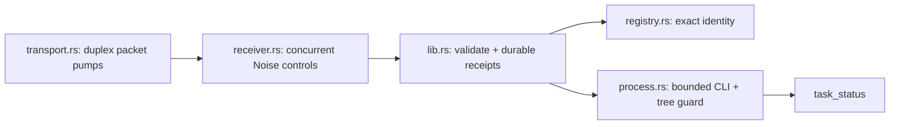

| File | What | Status |
|---|---|---|
| [lib.rs](lib.rs) | Private command admission; role/capability checks and durable replay receipts | ✅ synthetic tests |
| [registry.rs](registry.rs) | Strict owner TOML, exact workspace/session identity, bounded owner metadata discovery | ✅ synthetic tests |
| [process.rs](process.rs) | `AgentAdapter`, opt-in cloud handoff, subprocess exit/JSON checks, cleanup exit-status retention regression, opt-in smoke | ✅ fake CLIs; live providers unverified |
| [cloud.rs](cloud.rs) | Project cloud config, strict Session ID parsing, permission-override labels, uncertain launch receipts and repository checks | ✅ fake CLIs; live cloud unverified |
| [receiver.rs](receiver.rs) | Concurrent LAN/relay controls and three execution slots | ✅ synthetic Noise cancellation/revocation tests |
| [transport.rs](transport.rs) | Bounded split TCP/WebSocket pumps; shared core VRR1 epochs; preserve pending Noise reads | ✅ synthetic LAN/relay tests; deployment unverified |

Start at `receiver::serve`; REQ-34/41/44/60.
See [boundaries](../README.md) before embedding.
