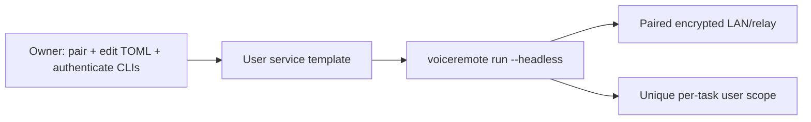

| File | What | Status |
|---|---|---|
| [voiceremote-agent.service](voiceremote-agent.service) | User unit with cgroup cleanup and private umask | 🟡 template; not installed/tested live |

Start with [desktop instructions](../../../README.md#agent-nodes); REQ-41/44.
Install under the existing owner user, never root. Check provider binary paths
and login storage first. The service uses SIGINT for graceful scope cleanup and retains service-wide
cgroup cleanup. Each task has a separate transient scope with an independent
runtime limit. `MemoryMax=2G` and `CPUQuota=100%` apply to the service and per-task
scopes; sizing is **TBC**. A working systemd user bus is needed for confirmed
termination. No bus/control failure means unconfirmed work, never cancelled.
Scopes manage process lifetime/resources; provider permissions remain separate.
