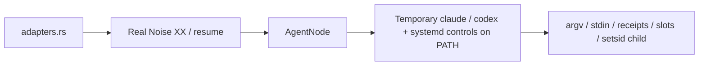

| File | What | Status |
|---|---|---|
| [adapters.rs](adapters.rs) | Synthetic Linux integration coverage; no real providers or keys | ✅ |
| [../src/process.rs](../src/process.rs) | Exit/signal unit test and env-gated live smoke | ✅ fake test; live smoke deliberately skipped |

Start: `HEAVY_CPUS=4 heavy cargo test -p voiceremote-agents --manifest-path
SW/desktop/Cargo.toml -j4`. REQ-34/41/44. Python 3 runs temporary fake executables;
scope/control fakes use only their own synthetic PID records (no process-environment scans). Only synthetic text is written in temporary directories. No parent PATH/env mutation.

Regressions cover same-connection LAN/relay cancel, revoke during execution, three
workers plus a control connection, escaped child sessions, unknown cleanup without
a bus or after control failure, retry after restart/expiry, restricted Claude
profiles, role/capability denial, flag-leading IDs and recovered Codex errors.
Cloud regressions also cover default-off TOML, project/origin allowlists, argv/stdin,
scrubbed env, real-shaped provider IDs, status markers, replay, unsupported cancel
and failure honesty. Deferred UI actions return unsupported without spawning.
Real systemd/cgroup enforcement and live providers remain **unverified**.

The failure-matrix fixture delays its fake launcher by 300 ms to reproduce loaded
CI startup. Non-timeout cases get a 5-second budget; the hung case still gets
200 ms. Exit 7 and timeout SIGKILL assertions remain exact. A separate process
regression proves an already observed exit 7 survives a later pipe deadline and
cleanup without a user bus. Real CI logs lacked that timing detail.

The escaped-child timeout regression uses a 1.5-second budget so Python can write
its PID under capped test concurrency before cleanup is checked. The earlier
200 ms budget intermittently killed the launcher before that fixture existed;
child liveness and confirmed/unconfirmed cleanup assertions are unchanged.

Cross-review regressions reject Claude titles as IDs, missing/duplicate ID lines,
and read-only cloud launches without explicit override. Active launch cancellation
stops the local tree; persisted launch receipts remain unknown after restart.
The argv/environment test launches an isolated copy of itself with synthetic
secret variables populated, verifies those inputs exist, then checks their names
are absent from both fake provider environments. No global test environment is changed.
