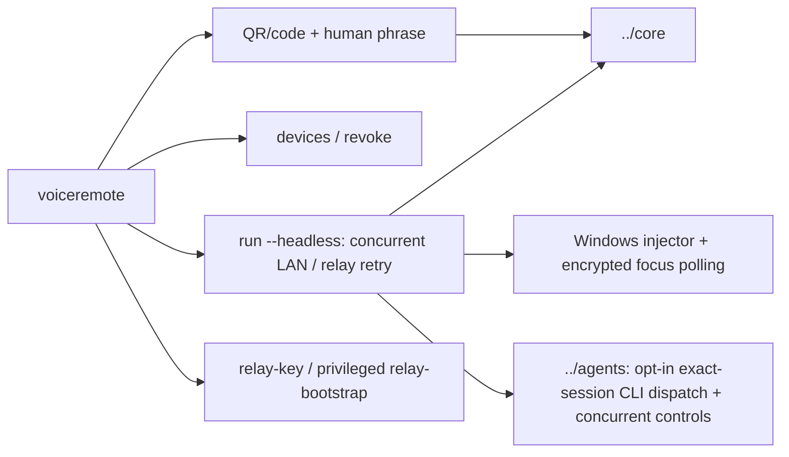

| Path | What it is | Status |
|---|---|---|
| [src/](src/) | CLI, trusted relay provisioning, Windows injection/focus wiring and receiver supervisors | ✅ synthetic tests; native Windows and physical phone unverified |
| [tests/](tests/) | CLI code pairing, persisted custom identity/restart, unknown/name/ID revoke, SIGINT during stalled handshake | ✅ |
| [Cargo.toml](Cargo.toml) | Binary + keychain opt-in; reserved tray feature | ✅ no Tauri |

Start with `cargo run -p voiceremote-app -- --help` from `SW/desktop`.
See [desktop README](../../README.md) for storage, LAN exposure and relay setup.
REQ-16/18–21/22–25/27/57. Windows selects `inject-windows`; focus reports travel
inside the authenticated Noise session. Native checks are [unverified](../inject-windows/manual-test.md).
Linux retains its unavailable adapter pending the parallel platform task.
`dictate toggle` reports a stub, and no provider command executes.
REQ-22–25/27. Dictation injector is unavailable until platform crates arrive;
`dictate toggle` reports a stub, provider execution is opt-in with headless `--agents-config` ([adapters](../agents/README.md), REQ-41/44).
