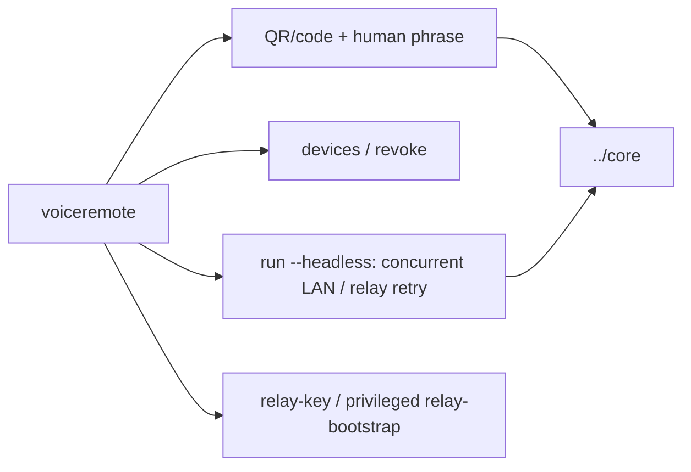

| Path | What it is | Status |
|---|---|---|
| [src/](src/) | CLI, trusted relay provisioning and receiver supervisors | ✅ build; physical phone unverified |
| [tests/](tests/) | CLI code pairing, persisted custom identity/restart, unknown/name/ID revoke, SIGINT during stalled handshake | ✅ |
| [Cargo.toml](Cargo.toml) | Binary + keychain opt-in; reserved tray feature | ✅ no Tauri |

Start with `cargo run -p voiceremote-app -- --help` from `SW/desktop`.
See [desktop README](../../README.md) for storage, LAN exposure and relay setup.
REQ-22–25/27. Dictation injector is unavailable until platform crates arrive;
`dictate toggle` reports a stub, and no provider command executes.
