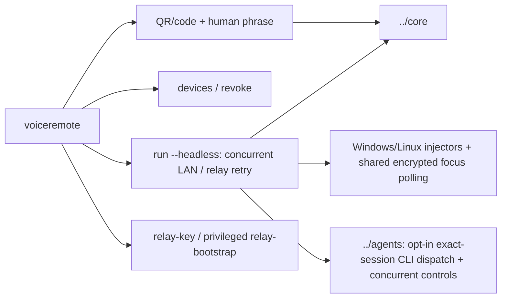

| Path | What it is | Status |
|---|---|---|
| [src/](src/) | CLI, trusted relay provisioning, Windows/Linux injection and shared focus wiring and receiver supervisors | ✅ synthetic tests; native Windows and physical phone unverified |
| [tests/](tests/) | CLI code pairing, persisted custom identity/restart, unknown/name/ID revoke, SIGINT during stalled handshake | ✅ |
| [Cargo.toml](Cargo.toml) | Binary + keychain opt-in; reserved tray feature | ✅ no Tauri |

Start with `cargo run -p voiceremote-app -- --help` from `SW/desktop`.
See [desktop README](../../README.md) for storage, LAN exposure and relay setup.
REQ-16/18–25/27/41/44/57. Windows and Linux use one encrypted focus/session driver.
Desktop mode selects the platform injector; `run --headless` requires no display.
Linux paste waits up to 30 seconds, restores if still owned, and reports unconfirmed
without retrying. Real Windows/GNOME behavior and phone UI are **unverified**.
`dictate toggle` is a stub. Provider execution requires headless `--agents-config`
([adapters](../agents/README.md)).
