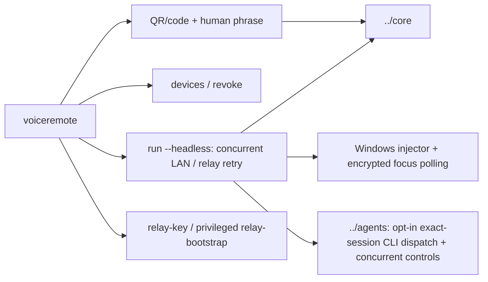

| Path | What it is | Status |
|---|---|---|
| [src/](src/) | CLI, fresh signed rooms/invites, Windows injection/focus, headless receiver and opt-in agent adapters | ✅ synthetic tests; native Windows and physical phone unverified |
| [tests/](tests/) | CLI pairing, persisted custom identity/restart, name/ID revoke and SIGINT during stalled handshake | ✅ |
| [Cargo.toml](Cargo.toml) | Binary, keychain opt-in, synthetic e2e-test injector and loopback access; reserved tray feature | ✅ no Tauri |

Start with `cargo run -p voiceremote-app -- --help` from `SW/desktop`.
See [desktop README](../../README.md) for storage, LAN exposure and relay setup.
REQ-16/18–21/22–25/27/57. Windows selects `inject-windows`; focus reports travel
inside authenticated Noise. Native checks remain [unverified](../inject-windows/manual-test.md).
Linux retains its unavailable adapter. `dictate toggle` reports a stub.
Provider execution is opt-in with headless `--agents-config`
([adapters](../agents/README.md), REQ-41/44).

`bash SYS/tests/e2e/run.sh` verifies actual Worker/Swift WebSocket and LAN
exchanges with the opt-in fixed synthetic TextInjector, including resume/revoke
and a real persisted stale queue.
