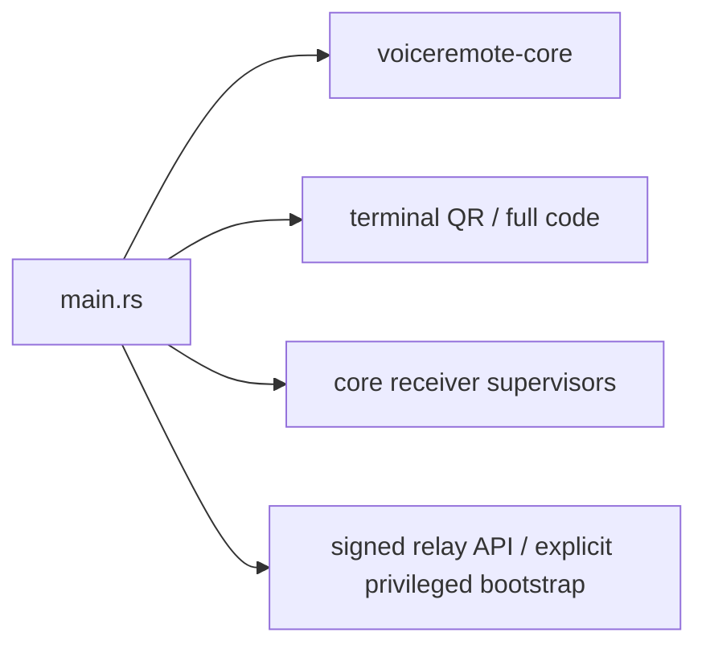

| File | What it is | Status |
|---|---|---|
| [main.rs](main.rs) | Pair, persisted device ID, name/ID revoke, signed relay provisioning, concurrent headless run and dictate stub | ✅ CLI tests; on-device unverified |

Start at `Cli` and `main`. Configuration/limitations are in
[desktop README](../../../README.md). REQ-22–25/27; no Tauri or injection backend.
