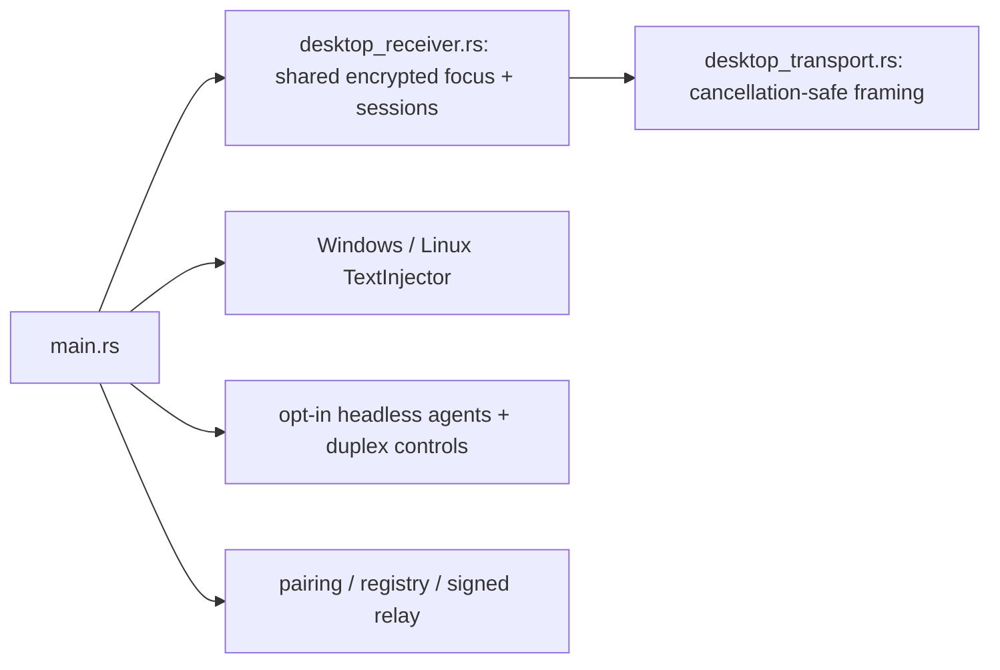

| File | What it is | Status |
|---|---|---|
| [main.rs](main.rs) | CLI, platform injector factory, headless agent opt-in | ✅ synthetic CLI tests |
| [desktop_receiver.rs](desktop_receiver.rs) | Shared Windows/Linux driver, content-free focus changes and 30-second heartbeat, core insertion status reports | ✅ encrypted session tests; native runtime unverified |
| [desktop_transport.rs](desktop_transport.rs) | LAN frame progress and relay keepalive retained across focus polls | ✅ synthetic fragmentation/relay tests |

Start at `Cli` and `main`; see [desktop README](../../../README.md).
REQ-16/18–25/27/41/44/57. Headless mode avoids both platform injectors.
Unknown focus reports false. Real desktops and phone UI remain **unverified**.
Keep these adapters aligned with core supervisors and wire validation.
