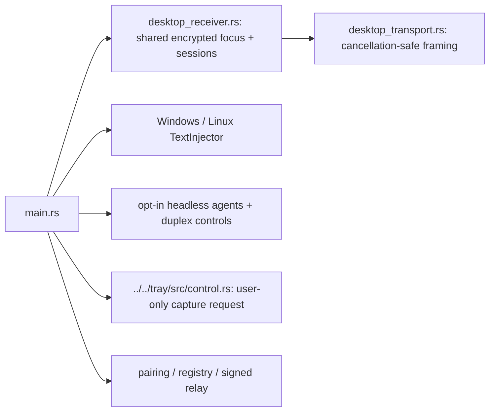

| File | What it is | Status |
|---|---|---|
| [main.rs](main.rs) | CLI, signed relay rooms/invites, platform injector factory, headless agent opt-in, real local toggle trigger | ✅ synthetic CLI tests |
| [desktop_receiver.rs](desktop_receiver.rs) | Shared Windows/Linux driver, content-free focus changes and 30-second heartbeat, core insertion status reports, encrypted capture requests and metadata-only tray observation | ✅ encrypted session tests; native runtime unverified |
| [desktop_transport.rs](desktop_transport.rs) | LAN frame progress and shared core VRR1 relay codec/keepalive retained across focus polls | ✅ synthetic fragmentation/relay tests |

Start at `Cli` and `main`; see [desktop README](../../../README.md).
REQ-16/18–25/27/41/44/57. Headless mode avoids both platform injectors.
Unknown focus reports false. Real desktops and phone UI remain **unverified**.
Keep these adapters aligned with core supervisors and wire validation.

The opt-in `e2e-test` feature adds a fixed synthetic TextInjector and explicit
loopback HTTP relay access for `SYS/tests/e2e/run.sh`. Production adapters remain
selected in ordinary builds.

Delivery: `desktop_receiver.rs` gates insertion on presentation readiness, sends correlated outcomes, reports native activity age and awaits capture-control results. `desktop_transport.rs` selects pairing by the first Noise packet. Socket evidence: [e2e](../../../../../SYS/tests/e2e/README.md); native display timing **unverified**.
