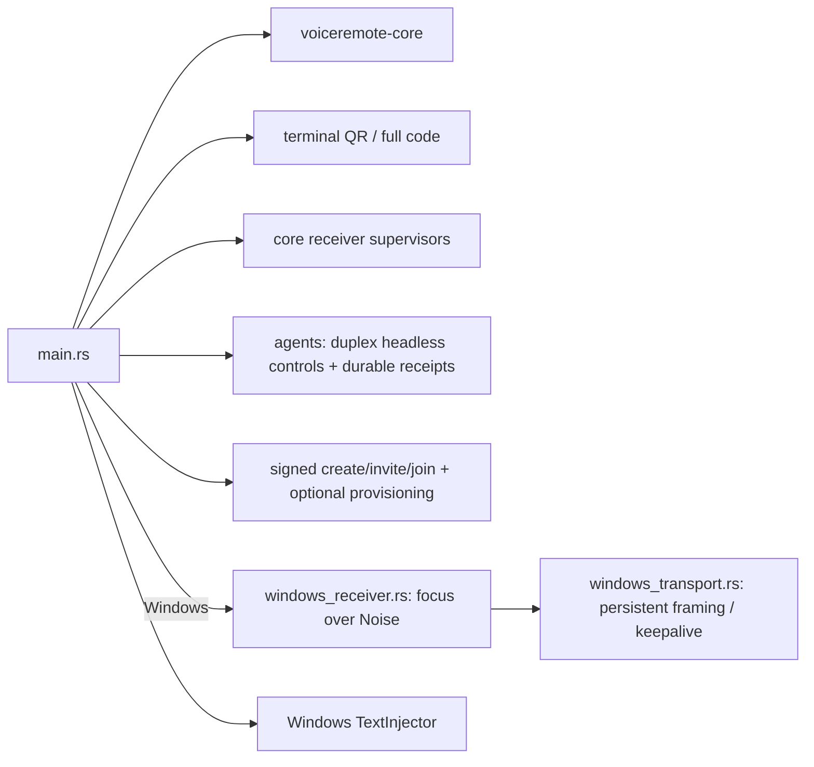

| File | What it is | Status |
|---|---|---|
| [main.rs](main.rs) | Pair, persisted identity, revoke, signed relay rooms, concurrent headless run and opt-in agent adapters | ✅ CLI + local Worker/Swift E2E; physical device unverified |
| [windows_receiver.rs](windows_receiver.rs) | Windows receiver; encrypted focus changes / 30-second heartbeat | ✅ synthetic Noise/fragmentation test; native runtime unverified |
| [windows_transport.rs](windows_transport.rs) | Windows LAN framing plus shared core VRR1 relay codec / persistent keepalive | ✅ synthetic partial-frame tests; native network unverified |

Start at `Cli` and `main`. Configuration/limitations are in the
[desktop README](../../../README.md). REQ-16/18–21/22–25/27/41/44/57.
Windows selects its injection backend; Linux reports unavailable. Agent execution
requires headless `--agents-config` and an owner allowlist. No Tauri/overlay.

Windows receiver mirrors core supervisors because the core API has no metadata
hook. Its LAN adapter retains partial reads across cancellation; relay delegates
to the shared core codec with persistent keepalive timers.

The opt-in `e2e-test` feature adds a fixed synthetic TextInjector and explicit
loopback HTTP relay access for `SYS/tests/e2e/run.sh`.
