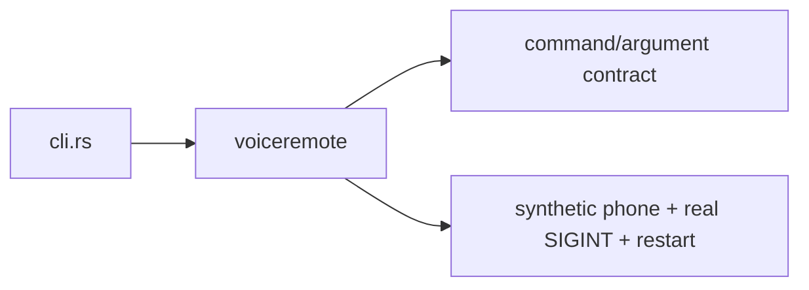

| File | What it is | Status |
|---|---|---|
| [cli.rs](cli.rs) | Command discovery, mode/transport conflicts, toggle stub, actual CLI code pair, persisted custom identity/restart, SIGINT while handshaking, unknown/name/ID revoke | ✅ |

Start: `cargo test -p voiceremote-app --manifest-path SW/desktop/Cargo.toml -j4`
from the repository root (use `heavy` on hwgeekom). REQ-22/27 CLI surface;
physical phone and terminal QR scanning remain **unverified**.
