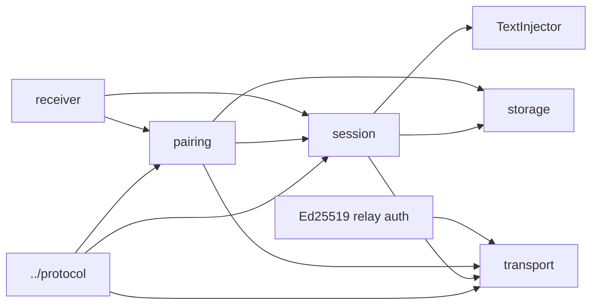

| Path | What it is | Status |
|---|---|---|
| [src/](src/) | Enrollment, storage, Noise session and TCP/WS implementations | ✅ synthetic tests |
| [tests/](tests/) | Security/lifecycle behavior, strict signed relay fake, token mutations, published vectors | ✅ |
| [Cargo.toml](Cargo.toml) | `os-keychain` opt-in; platform TLS backends | ✅ compile checks |

Start with [pairing.rs](src/pairing.rs), [tests](tests/security.rs) and the
[Noise profile](../../../../SYS/protocol/noise.md). REQ-16/22–25/27/34/60/61.
OS injection, deployed relay and phone interoperability remain **unverified**.
Embedders hold `ReceiverLease` for receiver lifetime, clone one `Registry`, and
close the transport after a receive/pairing error. `deliver` never executes tools.
