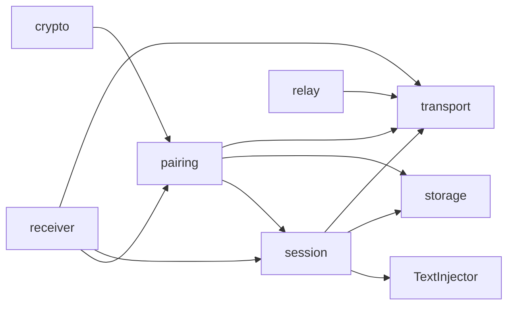

| File | Responsibility | Status |
|---|---|---|
| [lib.rs](lib.rs) | Public modules; compatible sync/async TextInjector and typed pre-input/uncertain failures | ✅ |
| [crypto.rs](crypto.rs) | Checked X25519 resolver rejects all-zero DH results | ✅ low-order peer tests |
| [relay.rs](relay.rs) | Ed25519 challenge auth, bootstrap, invite/join/revoke HTTP API | ✅ strict contract fake; deployed relay unverified |
| [receiver.rs](receiver.rs) | Four-connection LAN cap, cancellation, idle timeout, relay reconnect/backoff | ✅ lifecycle tests |
| [pairing.rs](pairing.rs) | Token issuance, XX, SAS, dual confirmation, authenticated reconnect | ✅ synthetic tests |
| [session.rs](session.rs) | Revocation/replay, fragments, non-fatal insertion status; retry only for certified pre-input failures | ✅ synthetic tests |
| [storage.rs](storage.rs) | KeyStore, registry, reservation outcomes, release only before input, persisted identity and receiver lease | ✅ file tests; live keychain unverified |
| [transport.rs](transport.rs) | Physical-interface selection, private LAN TCP/mDNS, WS framing/keepalive | ✅ loopback TCP/WS; real mDNS/TLS unverified |

Start at `pairing::accept` / `initiate`, then `PendingPair::finish` and
`Session::receive` / `deliver`. [Exact protocol](../../../../../SYS/protocol/noise.md).
REQ-16/22–25/27/34/60/61. No command adapter is executed in this phase.
