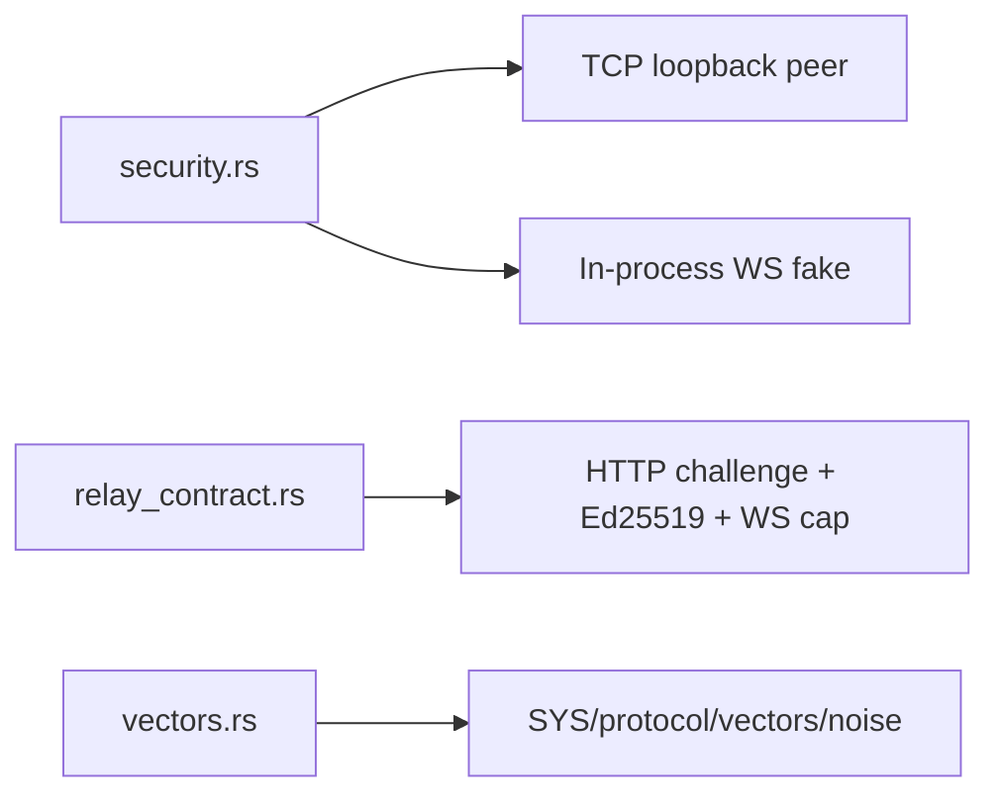

| File | Evidence | Status |
|---|---|---|
| [security.rs](security.rs) | Both transports, auth, revoke, dictation controls, safe pre-input retry, non-fatal phone error and durable uncertainty on reconnect, storage and bounded lifecycle | ✅ synthetic peers |
| [relay_contract.rs](relay_contract.rs) | Signed create/token-hash invite/join, server-time challenges/WS, replay, max dictation, reconnect and revoke | ✅ independent auth fake |
| [check-token-guards.py](check-token-guards.py) | Opt-in live-peer token-guard mutation proof; always restores source | ✅ baselines pass; removed guards fail at runtime |
| [vectors.rs](vectors.rs) | Deterministic XX/confirmation/application ciphertext fixture | ✅ Rust + Swift shared vectors |

Start: `HEAVY_CPUS=4 heavy cargo test -p voiceremote-core --manifest-path SW/desktop/Cargo.toml -j4`.
Run from repository root. Fixture regeneration is documented
[beside the fixture](../../../../../SYS/protocol/vectors/noise/README.md).
REQ-16/22–25/27/34. No real transcripts, audio or production secrets.
Human pairing time and live network/OS behavior remain **unverified**.

Run `python3 SW/desktop/crates/core/tests/check-token-guards.py` alone (no concurrent desktop build) to reproduce the token guard mutation checks. Re-run normal tests afterward.

The [real E2E gate](../../../../../SYS/tests/e2e/README.md) complements fakes with the production Worker, Rust CLI and Swift over actual WS/TCP, including persisted old-frame replay.
