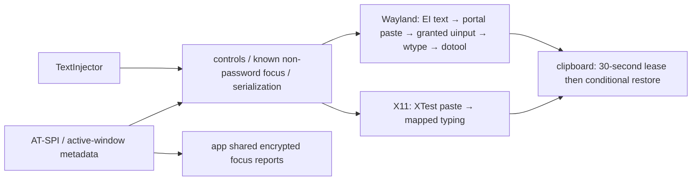

| Path | What it is | Status |
|---|---|---|
| [src/](src/) | Chooser, persistent portal/EIS actor, layout checks, clipboard ownership and focus | ✅ protocol doubles; live desktops **unverified** |
| [tests/](tests/) | Xvfb field and strict synthetic AT-SPI service | 🟡 compiled; coordinator CI run pending |
| [manual-test.md](manual-test.md) | GNOME Wayland/X11 acceptance and limitations | 🟡 owner run pending |
| [Cargo.toml](Cargo.toml) | Linux dependencies; dynamic libxkbcommon; no libxdo/build-time OS libraries | ✅ Linux build |

Start with [manual-test.md](manual-test.md). Trace: REQ-16, REQ-18–20, REQ-57.

| Boundary | Behavior |
|---|---|
| Portal | One RemoteDesktop session and one `ConnectToEIS`; keep EIS alive and process idle events. Use EI text if advertised, otherwise the EI keyboard with its XKB map. Notify is used only when EIS was never established. Unsupported keyboard/layout falls through before input. Permission token rotates in `$STATE_DIR/linux-input` (0700/0600). |
| Clipboard | Snapshot all readable formats (32 MiB / 256 targets cap); reject X11 INCR or oversized data before replacement. **Every queued clipboard paste returns `InsertionFailure::Unconfirmed`**. Keep the selection for 30 seconds regardless of reads, then restore saved formats only while still owner with the same generation. A newer copy wins. In-flight portal transfers hold their own byte snapshot. Report restoration failures honestly. No completion UI is required. A manager read proves no delivery; the encrypted session reports uncertainty and retains the replay claim, so replay cannot double-paste. Applications that request the clipboard after the bounded window remain **unverified**. |
| Keys/layout | Never emit Enter, Return, Tab or submit keys. Detect terminals through AT-SPI role/WM_CLASS and use Ctrl+Shift+V. X11 ignores actual lock modifiers and compensates CapsLock for ASCII typing. uinput requires an existing permission and proof that its physical Ctrl/Shift/V match the active layout; otherwise refuse. |
| Focus/privacy | Read roles/states/children, never names or field values. Password, invalid/unhandled role, incomplete tree, timeout and unknown focus refuse insertion. Editable text roles supported: Text, Entry, DocumentText; terminals have a separate path. Current wire text has no trusted explicit-versus-Auto signal, so the adapter conservatively refuses all unknown focus. `focus_report()` is sampled by the shared app driver; unknown/busy maps to false. No invented activity timestamp. Actual phone UI is **unverified**. |
| Helpers | Resolve only absolute executables in `/usr/bin`, `/bin`, `/usr/local/bin`; no PATH lookup. Literal validated stdin, no shell/argv text/helper output. GNOME skips wtype. Never fall back after possible delivery. |
| Recovery | Ignore BadWindow from a dying selection requestor; keep serving the restored clipboard. Rebuild a dead clipboard connection on the next safe attempt. Transport loss remains an error. Headless mode needs no display/injector. |

```sh
HEAVY_CPUS=4 RUST_TEST_THREADS=4 heavy cargo test -p voiceremote-inject-linux --manifest-path SW/desktop/Cargo.toml -j4
```

References: [portal lifecycle and EIS rules](https://flatpak.github.io/xdg-desktop-portal/docs/doc-org.freedesktop.portal.RemoteDesktop.html),
[Clipboard portal](https://flatpak.github.io/xdg-desktop-portal/docs/doc-org.freedesktop.portal.Clipboard.html),
[Hex](https://github.com/anomalyco/hex/blob/7c0b507133d6c802780d4f6793c648fb27abbef3/src/linux/clipboard.rs),
[Handy](https://github.com/cjpais/Handy/blob/82dfab9fda18c4bc24e1f6e56d36474d38eca0bc/src-tauri/src/clipboard.rs).
MIT notices: [DOCS/licences](../../../../DOCS/licences/).
