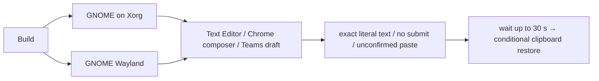

Purpose: owner acceptance for task 5, REQ-16/18–20/57. Inputs: built receiver,
synthetic fixture below, paired test phone. Results: **unverified** until recorded
by the owner. Use no real transcripts, credentials or messages.

| Step | GNOME Wayland | GNOME X11 | Pass evidence |
|---|---|---|---|
| Record environment | Record GNOME, distro, receiver version, `$XDG_SESSION_TYPE` | Same; choose “GNOME on Xorg” at login | Named OS/session, app versions |
| Start | `voiceremote run --account ACCOUNT --peer PEER` in an enrolled state directory | Same | No sudo, no extra input permissions needed |
| Permission | Approve the RemoteDesktop keyboard dialog; use a modifier-free trigger | No portal dialog expected | Only backend/reason diagnostics, no text |
| Insert | In each app, place caret inside an editable draft; deliver `synthetic é 日本語 🦀 -- literal fixture` from the paired phone | Same | Exact text at caret, existing text preserved, caret/focus stays in app |
| Never submit | Observe draft, multiline field, and a harmless local input event viewer | Same | No Enter, Return, KP Enter, Tab or Send; no new line/message/navigation |
| Clipboard | Before each insertion copy text, HTML, then an image; inspect the field and wait up to 30 seconds | Same | Paste reports unconfirmed; original formats restored automatically while still owner; no automatic retry |
| Newer clipboard | Copy a different synthetic value during insertion | Same | New copy survives; stale restore does not overwrite it |
| Restart | Restart receiver and insert again | Same | Portal token reused/rotated; repeat dialog only if compositor requires it |
| Revocation | Revoke keyboard permission using GNOME settings, retry, restart | N/A | Clear error; no false success, no duplicate retry |
| Password | Focus a synthetic password widget with AT-SPI enabled | Same | Denied where role detectable; API says Password and Auto boolean false |
| Unknown focus | Disable accessibility, stall a role query, or use an oversized accessibility tree | Same | Insertion refused; phone receives unavailable status; unknown focus reports false; no field values collected |
| Fallbacks | In a disposable session, deny portal; test already granted uinput, then optional wtype/dotool | Make clipboard snapshot unreadable; try mapped ASCII | Backend/reason shown; denied/unavailable transports return errors; no sudo |
| Locks / terminals | Repeat in a terminal with modifiers released; inspect event viewer | Repeat with NumLock/CapsLock on; force typing fallback with mixed-case ASCII | Ctrl+Shift+V for terminals; no pending quoted-insert; case preserved |
| Headless | Unset display/session-bus environment; use `run --headless` | Same | Agent runs without injector; dictation returns unavailable |

Keep the receiver alive while checking restored clipboard formats: Linux selection
ownership lives in the process. Portal/native clipboard support varies; without a
native Clipboard portal, the receiver needs GNOME's Xwayland clipboard bridge for
paste. Basic portal approval requests keyboard only, never a screen stream.

The shared app session driver samples the actual injector's focus metadata and
sends encrypted changes plus a 30-second heartbeat. Insertion refusals and unconfirmed delivery
produce encrypted TaskStatus reports without disconnecting; the actual phone UI is **unverified**.
Unknown focus always refuses: the current text wire record does not distinguish
a trusted explicit target selection from Auto.

Clipboard reads cannot prove delivery. Keep the selection for a full 30-second
window, then restore only if ownership and generation still match. Manager reads
do not shorten this window. A newer user copy wins. In-flight portal transfers
retain their byte snapshot. Restoration errors remain errors; apps requesting a
paste after the bounded window remain **unverified**. Unconfirmed delivery keeps
the durable segment claim; replay must report uncertainty without inserting again.
Wayland held physical modifiers are not reliably observable, so release them
before dictation. uinput refuses layouts it cannot verify. Never use real chats.

CI evidence is separate: coordinator dispatches `.github/workflows/desktop.yml`.
Its Xvfb synthetic field test proves X11 protocol behavior only. Record GNOME
Wayland and X11 app results separately; Windows Notepad acceptance is task 4.
