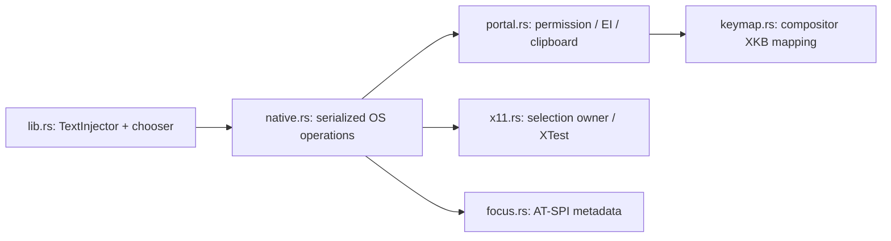

| File | What it is | Status |
|---|---|---|
| [lib.rs](lib.rs) | Defensive validation, chooser order, safe diagnostics, worker handle | ✅ synthetic tests |
| [paste.rs](paste.rs) | Bounded 30-second clipboard lease; reads never shorten it or confirm insertion | ✅ virtual-clock and portal tests |
| [native.rs](native.rs) | Runtime preflight/fallback, uinput and stdin helpers | 🟡 real devices/helpers unverified |
| [portal.rs](portal.rs) | Persistent grant/EIS actor, EI text or mapped keyboard, clipboard FD transfers and strict doubles | ✅ doubles; GNOME unverified |
| [x11.rs](x11.rs) | XTest key mapping, full-format snapshot, selection owner, layout defence and restoration | 🟡 Xvfb CI pending |
| [keymap.rs](keymap.rs) | Compile compositor XKB maps into bounded Rust key bindings; no physical V guess | ✅ US/Dvorak fixtures |
| [focus.rs](focus.rs) | Bounded accessibility walk; password/terminal/known-text-role checks, unknown refusal and trusted idle metadata | ✅ classification; live accessibility unverified |

Start at `lib.rs::insert`; see [crate README](../README.md) for limits and
REQ-16/18–20/57 traceability. No field contents or native/helper errors are logged.
