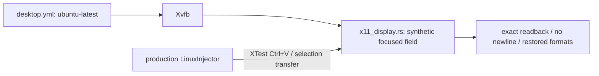

| File | What it is | Status |
|---|---|---|
| [x11_display.rs](x11_display.rs) | Real readback, bounded automatic restore, delayed field after manager reads, newer copies, Caps/Num locks, terminal quoted-insert trap, dead requestor, password/unknown refusal and typing fallback | 🟡 compiled locally; execution CI-only, **unverified** |

| [a11y.rs](a11y.rs) | Strict AT-SPI service for the Xvfb field; role/large-tree/timeout controls, no field contents | ✅ compiled; CI execution pending |

REQ-16/19/20. The test is ignored in normal workspace runs: no display server
exists on the build host. The coordinator manually dispatches Desktop CI, where
`xvfb-run -a cargo test -p voiceremote-inject-linux --test x11_display -j4 -- --ignored --test-threads=1`
runs with `XDG_SESSION_TYPE=x11`. Unit tests in `src/portal.rs` use an isolated
D-Bus daemon and Unix socket/FD doubles; they need no real desktop or permissions.
