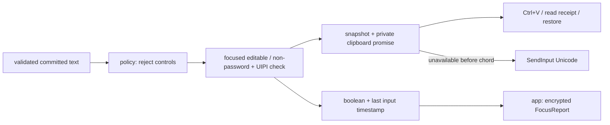

| Path | What it is | Status |
|---|---|---|
| [src/](src/) | Linux-testable policy; Windows-only native TextInjector and UIA | 🟡 synthetic tests; native runtime unverified |
| [examples/](examples/) | Owned edit-window smoke and timed manual insertion | 🟡 Windows CI execution pending |
| [manual-test.md](manual-test.md) | Owner's Notepad, Chrome, Teams and privacy checklist | ⬜ owner checks unverified |
| [../../../../DOCS/licences/](../../../../DOCS/licences/) | Pinned Handy/Hex MIT provenance | ✅ notices retained |

Start with `cargo test -p voiceremote-inject-windows -j4` from `SW/desktop`.
REQ-16, REQ-18–21, REQ-57. Native implementation and `TextInjector` export are
`cfg(windows)`; policy compiles on Linux. No overlay is created.

Insertion waits 50 ms before Ctrl+V, then waits up to 750 ms for a clipboard
read and 150 ms to settle. These are **unverified** application compatibility
choices. A read receipt proves clipboard consumption, not text insertion by
every application. Only the owned smoke window reads back inserted text.
Unicode fallback means Windows accepted the complete event batch; arbitrary
app acceptance still requires the owner checklist.

All readable HGLOBAL formats are copied before changing the clipboard.
Unsupported handle formats (including bitmap/metafile), unreadable/oversized
snapshots, or unavailable clipboard privacy markers use Unicode fallback
without overwriting the clipboard. Snapshots are capped at 64 MiB total.
Restoration checks owner and sequence while holding the clipboard lock; a newer
user copy wins. Delayed rendering can advance the sequence under the transaction's
unique owner window; that change still permits restoration.
Restore contention retries for two seconds and reports an error
on failure; Windows/process crashes or prolonged external locks can prevent
restoration. Third-party clipboard monitors need not honor Windows opt-outs.

No Enter, Tab, submit path, field contents, titles or transcript logging.
Unknown UIA properties fail closed. Focus is rechecked immediately before input;
the OS offers no atomic focus-and-SendInput operation, so a simultaneous user
focus change remains a runtime race to exercise manually. Elevated targets fail
before clipboard mutation when their integrity exceeds the receiver's.

API basis: [clipboard privacy formats](https://learn.microsoft.com/en-us/windows/win32/dataxchg/clipboard-formats#cloud-clipboard-and-clipboard-history-formats),
[SendInput / UIPI limitations](https://learn.microsoft.com/en-us/windows/win32/api/winuser/nf-winuser-sendinput).
Delayed-render sequence behavior: [GetClipboardSequenceNumber](https://learn.microsoft.com/en-us/windows/win32/api/winuser/nf-winuser-getclipboardsequencenumber).
