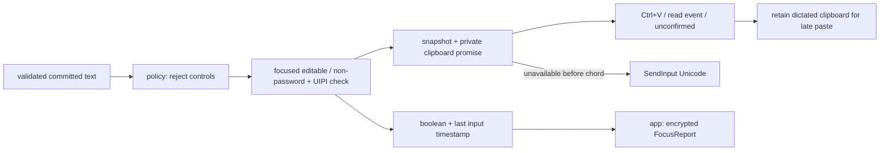

| Path | What it is | Status |
|---|---|---|
| [src/](src/) | Linux-testable policy; Windows-only native TextInjector and UIA | 🟡 synthetic tests; native runtime unverified |
| [examples/](examples/) | Owned edit-window smoke, desktop-acquisition regression tests, and timed manual insertion | 🟡 Windows CI execution pending |
| [manual-test.md](manual-test.md) | Owner's Notepad, Chrome, Teams and privacy checklist | ⬜ owner checks unverified |
| [../../../../DOCS/licences/](../../../../DOCS/licences/) | Pinned Handy/Hex MIT provenance | ✅ notices retained |

Start with `cargo test -p voiceremote-inject-windows -j4` from `SW/desktop`.
REQ-16, REQ-18–21, REQ-57. Native implementation and `TextInjector` export are
`cfg(windows)`; policy compiles on Linux. No overlay is created.

Insertion waits 50 ms before Ctrl+V, then up to 30 seconds for a clipboard
read event and a full 150 ms to settle after any read (including late reads).
These timings remain **unverified** on the owner's apps. Any reader can trigger
rendering; a monitor is not insertion proof. Generic clipboard paste therefore
returns `InsertionFailure::Unconfirmed`, never insertion success. **After a chord
may have been queued, dictated text stays on the private clipboard.** Restoring
an old clipboard could feed a secret to delayed Teams Ctrl+V. The smoke test
independently verifies its own HWND and requires `WM_PASTE`; production never
reads target contents. Clipboard restoration after generic paste is deferred
until a trustworthy target acknowledgement exists (**TBD**).

Supported HGLOBAL formats are snapshotted before publication. A pre-chord abort
restores them with ownership checks. Unsupported formats, unreadable/oversized
snapshots, or unavailable privacy markers select Unicode fallback without
changing the clipboard. Snapshots are capped at 64 MiB. A newer user copy wins.
Unicode event acceptance is distinct from arbitrary application readback.
History/cloud opt-outs remain set on retained dictation; third-party monitors
need not honor them. No original clipboard is restored after queued input,
even on timeout, rendering failure, provider error, or cancellation.

One provider job runs at a time, with no queue. The async entry waits through
`spawn_blocking` and a 35-second timeout. A hung provider retains capacity until
it exits; input commits atomically against cancellation before SendInput. A timeout before
that commit is retryable; after it, delivery remains uncertain. No Tokio worker waits on
an unbounded `join`. Linux tests cover timeout, retained capacity, and suppression
of input after cancellation.

Core reports insertion failures without closing the session. Existing
`TaskStatus.command_id` carries `segment_id`: `failed/unavailable` means no input
was queued and the same segment can retry; `failed/error` means uncertain,
retained durable claim, no automatic retry (also after reconnect). Untyped errors
from existing injectors are conservatively uncertain. Successful legacy adapters
retain their existing no-ack behavior. No wire schema changed.

No Enter, Tab, submit path, field contents, titles or transcript logging.
Unknown UIA properties fail closed. Focus is rechecked immediately before input;
the OS offers no atomic focus-and-SendInput operation, so a simultaneous user
focus change remains a runtime race to exercise manually. Elevated targets fail
before clipboard mutation when their integrity exceeds the receiver's.

API basis: [clipboard privacy formats](https://learn.microsoft.com/en-us/windows/win32/dataxchg/clipboard-formats#cloud-clipboard-and-clipboard-history-formats),
[SendInput / UIPI limitations](https://learn.microsoft.com/en-us/windows/win32/api/winuser/nf-winuser-sendinput).
Delayed-render sequence behavior: [GetClipboardSequenceNumber](https://learn.microsoft.com/en-us/windows/win32/api/winuser/nf-winuser-getclipboardsequencenumber).
