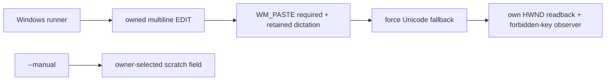

| File | What it is | Status |
|---|---|---|
| [desktop-smoke.rs](desktop-smoke.rs) | Automated owned-window check with explicit WM_PASTE and exact readback; `--manual` inserts a synthetic sample after 8 seconds | 🟡 cross-compiled; Windows runtime unverified |

Run `cargo run -p voiceremote-inject-windows --example desktop-smoke -j4`
from `SW/desktop` **in an isolated test desktop**: automated mode deliberately
replaces the clipboard with synthetic fixtures. Reports `SKIPPED: reason` when
the process or worker cannot acquire/bind an input desktop with create-window,
read and write rights, or cannot focus its test window. Desktop-acquisition
errors include the HRESULT (including access denied). Once usable, an
injection/readback failure fails. Synthetic tests exercise both outcomes.
Laptop use: follow [manual-test.md](../manual-test.md). REQ-16/18–21/57.

Desktop APIs: [OpenInputDesktop](https://learn.microsoft.com/en-us/windows/win32/api/winuser/nf-winuser-openinputdesktop), [SetThreadDesktop](https://learn.microsoft.com/en-us/windows/win32/api/winuser/nf-winuser-setthreaddesktop).
