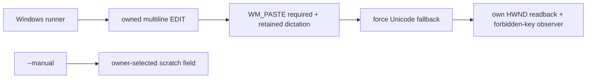

| File | What it is | Status |
|---|---|---|
| [desktop-smoke.rs](desktop-smoke.rs) | Automated owned-window check with explicit WM_PASTE and exact readback; `--manual` inserts a synthetic sample after 8 seconds | 🟡 cross-compiled; Windows runtime unverified |

Run `cargo run -p voiceremote-inject-windows --example desktop-smoke -j4`
from `SW/desktop` **in an isolated test desktop**: automated mode deliberately
replaces the clipboard with synthetic fixtures. Reports `SKIPPED: reason` when
the process or worker cannot acquire/bind an input desktop with create-window,
read and write rights, or cannot focus its test window. Desktop-acquisition
errors include the API and HRESULT. Window creation/subclass/focus, owned-window
read access, clipboard open and fixture clipboard publication also skip **only**
explicit access denial. Other OS errors, missing clipboard formats, privacy/data
verification and wrong readback always fail; an HRESULT in an error string never
authorizes a skip. Acquisition and exercise paths use the same classifier in the
process and worker. Synthetic tests inject API-specific denials and wrong results.

The `ci3.log` failure contained only an unlabelled access-denied HRESULT, so the
exact API remains **unverified**. It does not contain the injector's distinct
SendInput failure diagnostic. New diagnostics distinguish window, clipboard,
allocation, readback and injector errors without field contents.
Laptop use: follow [manual-test.md](../manual-test.md). REQ-16/18–21/57.

Desktop APIs: [OpenInputDesktop](https://learn.microsoft.com/en-us/windows/win32/api/winuser/nf-winuser-openinputdesktop), [SetThreadDesktop](https://learn.microsoft.com/en-us/windows/win32/api/winuser/nf-winuser-setthreaddesktop).

Clipboard/input contracts: [OpenClipboard](https://learn.microsoft.com/en-us/windows/win32/api/winuser/nf-winuser-openclipboard), [GetClipboardData](https://learn.microsoft.com/en-us/windows/win32/api/winuser/nf-winuser-getclipboarddata), [SendInput](https://learn.microsoft.com/en-us/windows/win32/api/winuser/nf-winuser-sendinput).
