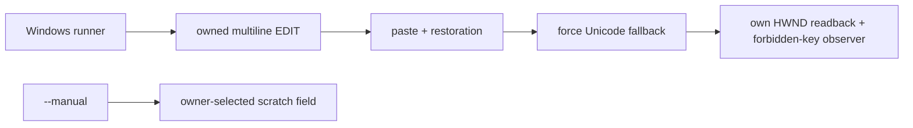

| File | What it is | Status |
|---|---|---|
| [desktop-smoke.rs](desktop-smoke.rs) | Automated owned-window check; `--manual` inserts a synthetic sample after 8 seconds | 🟡 cross-compiled; Windows runtime unverified |

Run `cargo run -p voiceremote-inject-windows --example desktop-smoke -j4`
from `SW/desktop` **in an isolated test desktop**: automated mode deliberately
replaces the clipboard with synthetic fixtures. Reports `SKIPPED: reason` when
no usable foreground desktop exists; an injection/readback failure fails.
Laptop use: follow [manual-test.md](../manual-test.md). REQ-16/18–21/57.
