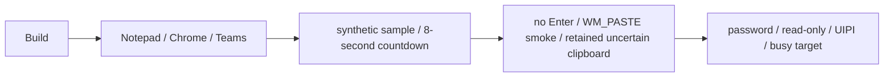

Purpose: owner acceptance for task 4, REQ-16/18–21/57.
Inputs: synthetic sample only; owner's Windows laptop and installed apps.
Verification: **unverified** until the owner records results. Never record real
transcripts, messages, credentials, audio, private screenshots or keys.

1. From `SW/desktop` in PowerShell:

   ```powershell
   cargo test --workspace -j4
   cargo build -p voiceremote-inject-windows --example desktop-smoke -j4
   cargo build -p voiceremote-app --features os-keychain -j4
   ```

2. Copy `Synthetic clipboard sentinel`, run
   `cargo run -p voiceremote-inject-windows --example desktop-smoke -j4 -- --manual`,
   and focus blank Notepad during the eight-second countdown. Expect exactly
   `Synthetic café 漢字 🦀` at the caret, no newline, and focus retained.
   Generic paste reports **UNCONFIRMED** because a clipboard reader cannot prove
   insertion. The dictated sample stays on the clipboard with history/cloud
   opt-outs. **Do not expect the sentinel restored after queued Ctrl+V**: a busy
   target could otherwise paste an old clipboard secret. Verify the field
   visually; do not automatically retry an uncertain segment.

3. Repeat in a Chrome scratch textarea/contenteditable and Teams' **unsent draft**
   on a test chat or offline compose surface. Confirm no Send or field navigation.
   Repeat with a different keyboard layout and emoji. A Unicode fallback reports
   event acceptance; still verify app behavior visually. Unsupported clipboard
   formats (for example a native bitmap) must choose fallback and preserve that
   original clipboard. A newer user copy must never be overwritten.

4. Focus blank password and read-only controls, then repeat while holding Shift.
   Expect rejection before input; passwords/read-only report `focused=false`.
   No clipboard replacement or text insertion. Target elevated Notepad from an
   ordinary receiver: expect a clear UIPI error, never false success. Use only a
   synthetic empty password field, never a real credential.

5. Deliberately stall a scratch target while it has keyboard focus (where safely
   reproducible). A queued Ctrl+V without a read waits up to 30 seconds; a late
   read gets its full 150 ms settle period. It reports unconfirmed and leaves
   dictated text, so a resumed target cannot paste the previous sentinel/secret.
   A clipboard monitor's early read must not produce an insertion-success claim.
   Record any wrong-field or old-clipboard insertion as a failure.

6. Enable clipboard history/cloud sync on a test account where permitted. Win+V
   and a second test device must not show the dictated sample in history/cloud.
   The active local clipboard intentionally retains uncertain dictation.
   Windows version/settings and third-party monitor behavior remain unverified.

7. Pair using the desktop README and run:

   ```powershell
   cargo run -p voiceremote-app --features os-keychain -- --keychain run --headless --account ACCOUNT --peer PEER
   ```

   Observe encrypted FocusReport changes: account/device, boolean, last input
   timestamp only. Stable metadata is quiet between 30-second heartbeats;
   focus/input changes are sampled each second. Polling must not invent activity.
   Dictate synthetic text in each app. On password/held Shift, the phone receives
   TaskStatus with `command_id = segment_id`, `failed/unavailable`; focus a safe
   field/release Shift and retry **the same segment without reconnecting**.
   Unconfirmed input reports `failed/error`, remains deduplicated even after
   reconnect, and requires explicit visual reconciliation rather than retry.

| Check | Laptop / OS / app version | Result |
|---|---|---|
| Notepad / Chrome / Teams literal text, no Enter/Send | TBD | unverified |
| Password/read-only/modifier/UIPI denial and retry | TBD | unverified |
| Uncertain paste keeps dictation; late target/monitor cannot expose old clipboard | TBD | unverified |
| Fallback preserves original clipboard; history/cloud opt-out | TBD | unverified |
| Phone failure status, reconnect deduplication, sparse focus reports | TBD | unverified |

Coordinator: manually dispatch `.github/workflows/desktop.yml` after committing.
Automated smoke uses an owned EDIT, requires exactly one WM_PASTE plus exact
readback, then proves Unicode fallback with no second WM_PASTE. It checks that
uncertain paste retains dictation and fallback preserves the sentinel. It skips
only with a concrete unavailable-desktop reason; injection errors fail. Automated
mode seeds synthetic clipboard fixtures: use `--manual` on the owner's laptop.
