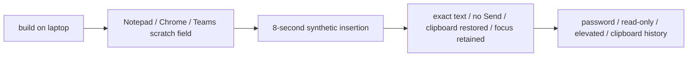

Purpose: owner acceptance for task 4, REQ-16/18–21/57.
Inputs: this crate's synthetic sample; owner's Windows laptop and installed apps.
Verification: **unverified** until the owner records results. No real transcripts,
messages, credentials, audio, screenshots of private data, or keys in results.

1. In PowerShell, from `SW/desktop`, run:

   ```powershell
   cargo test --workspace -j4
   cargo build -p voiceremote-inject-windows --example desktop-smoke -j4
   cargo build -p voiceremote-app --features os-keychain -j4
   ```

2. Copy a synthetic clipboard sentinel (for example `Clipboard sentinel`).
   Run `cargo run -p voiceremote-inject-windows --example desktop-smoke -j4 -- --manual`.
   During its eight-second countdown, focus a blank Notepad document.
   Expect exactly `Synthetic café 漢字 🦀`, at the caret, without a newline.
   Confirm the caret remains in the field and the console reports `focused=true`.
   Paste into a separate scratch field afterward: expect the original sentinel.

3. Repeat step 2 in Chrome with a scratch `<textarea>` / contenteditable, and
   in Teams' **unsent draft** compose field. Use a private test chat or an
   offline compose surface. Confirm no message is sent and no field navigation
   occurs. Repeat at a non-default keyboard layout and with emoji.

4. Repeat after copying rich text, a synthetic image, and a synthetic file.
   Check original clipboard data/formats survive. Unsupported native formats
   deliberately choose Unicode fallback; their original clipboard stays intact.
   Run back-to-back insertions and copy a new synthetic sentinel during paste:
   restoration must preserve the newer user copy. Busy clipboard / held Shift,
   Ctrl, Alt or Windows keys must give a clear error or a safe pre-chord fallback.

5. In Chrome, focus a blank password input, then a read-only input. Run the
   timed manual command for each. Expect `focused=false`, an error, and no
   insertion or clipboard replacement. Do not enter or expose a real password.
   With an ordinary receiver terminal, target an elevated Notepad: expect a
   clear UIPI/elevation error and no insertion. Do not elevate the receiver to
   bypass this check.

6. Enable Windows clipboard history/cloud sync if permitted on the test account.
   After successful insertion, use Win+V: the synthetic dictated sample must not
   appear. Check a second test device's cloud clipboard where available.
   Record Windows version/settings and pass/fail; monitors outside Windows'
   clipboard policy remain **unverified**.

7. With the phone paired using the desktop README flow, run
   `cargo run -p voiceremote-app --features os-keychain -- --keychain run --headless --account ACCOUNT --peer PEER`.
   Observe the authenticated phone's FocusReport: correct account/device,
   boolean focus and last activity only, approximately once per second.
   Switch between editable, password, read-only, and non-editable controls.
   Password / unknown metadata reports false. An idle field must not get a new
   activity timestamp just because it is polled. Dictate synthetic text to the
   selected desktop in each of the three apps; confirm no Enter/Send.

8. Change focus during the countdown and during insertion, lock the desktop,
   and restart the receiver. Check safe failure and no false success on a
   blocked target. Extremely close focus changes remain a Win32 race; record
   any wrong-field insertion as a failure.

| Check | Laptop / OS / app version | Result |
|---|---|---|
| Notepad literal + no Enter + restore | TBD | unverified |
| Chrome textarea/contenteditable + no Enter + restore | TBD | unverified |
| Teams draft + no Send + restore | TBD | unverified |
| Password / read-only / elevated denial | TBD | unverified |
| Rich/image/file/new copy clipboard preservation | TBD | unverified |
| History / cloud opt-out | TBD | unverified |
| Phone encrypted focus changes / real activity time | TBD | unverified |
| Focus retained / race / locked desktop | TBD | unverified |

Coordinator: manually dispatch `.github/workflows/desktop.yml` after committing.
The owned EDIT smoke can pass or explicitly skip with runner-session reason;
it does not verify Notepad, Chrome or Teams. Do not run automated smoke mode on
the owner's regular clipboard: it seeds synthetic fixtures. Use `--manual`.
