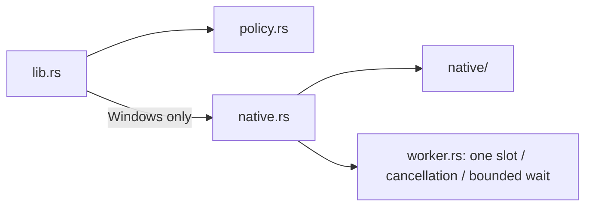

| File | What it is | Status |
|---|---|---|
| [lib.rs](lib.rs) | Platform export boundary | ✅ Linux / Windows compile |
| [policy.rs](policy.rs) | Text guard, event plans, editable focus, timestamp, restore and fallback policy; unit tests | ✅ synthetic tests |
| [worker.rs](worker.rs) | Bounded provider job, spawn_blocking wait, timeout/cancellation; Linux regression | ✅ synthetic tests |
| [native.rs](native.rs) | Serialized insertion worker and metadata sampler | 🟡 Windows runtime unverified |
| [native/](native/) | Clipboard, UIA/privilege and SendInput APIs | 🟡 Windows runtime unverified |

Start at `policy::insert`; REQ-16/18–21/57. Tests use synthetic text only.
