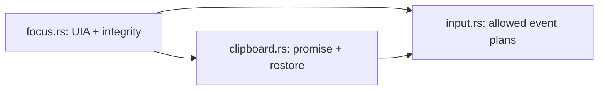

| File | What it is | Status |
|---|---|---|
| [focus.rs](focus.rs) | COM apartment, focused-control metadata, read-only/password guard, integrity comparison, last input time | 🟡 runtime unverified |
| [clipboard.rs](clipboard.rs) | Private delayed-render clipboard transaction; complete supported-format snapshot and guarded restore | 🟡 runtime unverified |
| [input.rs](input.rs) | Ctrl+V or Unicode only, scan codes, modifier guard, short-send error | 🟡 runtime unverified; mapping unit test in Windows CI |

Start at `Target::capture` and `clipboard::paste`. REQ-16/18–21/57.
MIT adaptation headers and notices are mapped in
[licences](../../../../../../DOCS/licences/README.md).
