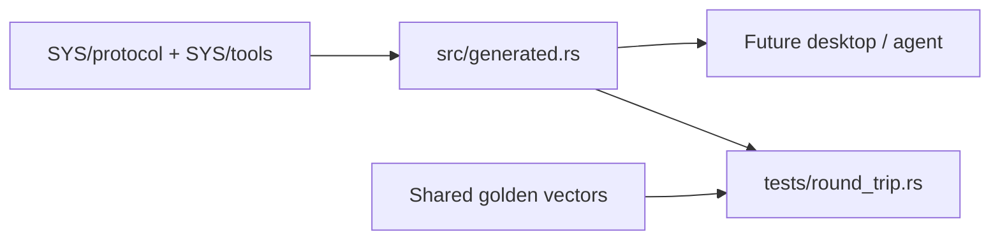

| File / folder | What it is | Status |
|---|---|---|
| [Cargo.toml](Cargo.toml) | `voiceremote-protocol`, first desktop workspace member | ✅ Linux |
| [src/](src/) | Generated types and validated codecs | ✅ |
| [tests/](tests/) | Shared typed round-trip and rejection tests | ✅ |

Start with `voiceremote_protocol::decode::<InnerMessage>(json)` and `encode(&value)`.
Use these codecs at boundaries; raw serde does not enforce every schema constraint.
Run `heavy cargo test -j4 -p voiceremote-protocol --manifest-path SW/desktop/Cargo.toml`
from the root, or `make -C SYS check` for all contract checks. Cargo creates a
workspace lockfile; the Make recipe cleans it up if it did not already exist.

Edit `SYS/protocol` / `SYS/tools`, then regenerate. Trace: product §4/§7;
[REQ-59](../../../../SYS/requirements.md#extensibility), [REQ-61](../../../../SYS/requirements.md#extensibility). Noise, policy, dispatch and Windows linking are **unverified** here.

Wire parsing rejects duplicates, lone surrogates, underflow and nonliteral integer spellings before typed serde decoding.

Paired agent inventory, exact-session retained-preview dispatch and durable task queries are generated from SYS/protocol. Shared vectors cover the new typed records and reject added authority fields.
