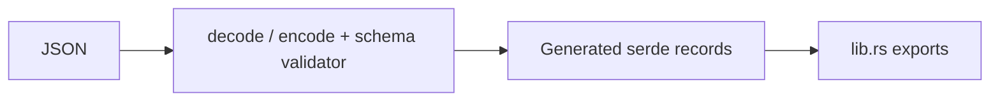

| File | What it is | Status |
|---|---|---|
| [lib.rs](lib.rs) | Public protocol module | ✅ |
| [generated.rs](generated.rs) | Generated records, unions, schema and codecs | ✅ shared vectors |

Start with `decode`/`encode`; regenerate from `SYS` instead of editing generated
Rust. Trace: product §4/§7; [REQ-59](../../../../../SYS/requirements.md#extensibility), [REQ-61](../../../../../SYS/requirements.md#extensibility). Cryptographic enforcement is future work.

A strict recursive parser retains integer token kinds and rejects duplicate decoded keys at every object depth.

Generated delivery contract includes target prepare/ready, dictation outcome/query, expiring capture-control/result, optional activity age and actual listening state. Edit SYS schema, then regenerate.
