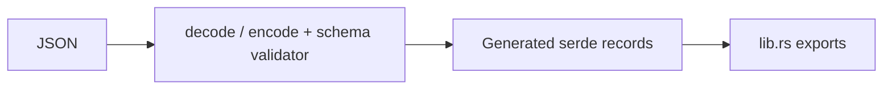

| File | What it is | Status |
|---|---|---|
| [lib.rs](lib.rs) | Public protocol module | ✅ |
| [generated.rs](generated.rs) | Generated records, unions, schema and codecs | ✅ shared vectors |

Start with `decode`/`encode`; regenerate from `SYS` instead of editing generated
Rust. Trace: product §4/§7; `[REQ-n]` is TBD. Cryptographic enforcement is future work.
