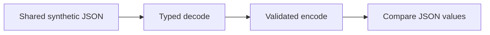

| File | What it is | Status |
|---|---|---|
| [round_trip.rs](round_trip.rs) | All record/union types including archive block/read/page, malformed fixtures and encode checks | ✅ Linux |

Start with the tests; shared JSON is included from `SYS/protocol/vectors` at
compile time. Trace: product §4/§7; [REQ-59](../../../../../SYS/requirements.md#extensibility), [REQ-61](../../../../../SYS/requirements.md#extensibility).

Raw invalid fixtures exercise original JSON token strings without reparsing or normalization.

Typed round trips cover every new delivery/control record and optional preparation/activity/listening fields through the shared SYS vectors.
