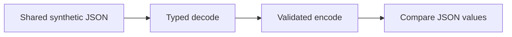

| File | What it is | Status |
|---|---|---|
| [round_trip.rs](round_trip.rs) | All record/union types, malformed fixtures and encode checks | ✅ Linux |

Start with the tests; shared JSON is included from `SYS/protocol/vectors` at
compile time. Trace: product §4/§7; `[REQ-n]` is TBD.
