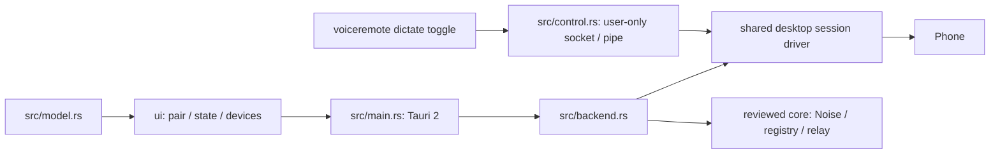

| Path | Purpose | Status |
|---|---|---|
| [src/](src/) | Plain state, pairing, receiver and local control; optional Tauri shell | 🟡 synthetic tests; native GUI unverified |
| [ui/](ui/) | Bundled HTML/CSS/JS; no remote scripts or transcript display | 🟡 native accessibility/focus unverified |
| [icons/](icons/) | Original D glyph installer assets | ✅ generated locally |
| [tauri.bundle.conf.json](tauri.bundle.conf.json) | CI bundles the native `voiceremote` hotkey CLI beside the GUI | 🟡 installed paths unverified |
| [tauri.conf.json](tauri.conf.json) | Windows NSIS; Linux deb/AppImage; nonfocusable overlay | 🟡 CI bundles unverified |
| [Cargo.toml](Cargo.toml) | Default plain library, `gui` enables Tauri; MIT OR Apache-2.0 | ✅ headless has no GTK/WebKit |

Start with [desktop setup and limits](../../README.md). Trace: REQ-18, REQ-21–25,
REQ-57; journey A. These are implementation traces, **not acceptance claims**.

```text
Voice Receiver                     [tray: D/A + listening dot]
  Dictation / AI Control            Listening / Not listening / Unknown
  Destination                      Last authenticated target on this receiver
  Pair a phone                     QR → four words → confirm on both
  Paired devices                   Name · Role · Revoke
  Start when I sign in             Off by default
```

Local tests: `cargo test -p voiceremote-tray -j4`. GUI builds only in desktop CI:
`cargo build -p voiceremote-tray --features gui -j4` needs native GTK/WebKit on
Linux. Tauri's [tray](https://v2.tauri.app/learn/system-tray/) and
[autostart](https://v2.tauri.app/plugin/autostart/) APIs are used from Rust.
No Hex/Handy/VoiceInk code was copied.
