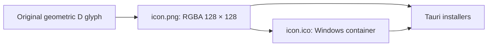

| File | Purpose | Status |
|---|---|---|
| [generate.py](generate.py) | Reproducible original geometric artwork; run with Python 3 | ✅ bytes verified |
| [icon.png](icon.png) | Original installer/application glyph | ✅ RGBA PNG |
| [icon.ico](icon.ico) | Same PNG in an ICO container | ✅ encoded; Windows rendering unverified |

Start with `icon.png`; runtime tray icons are drawn by `src/model.rs`, including
D/A shapes and a listening dot. No external artwork or reused licence applies.
