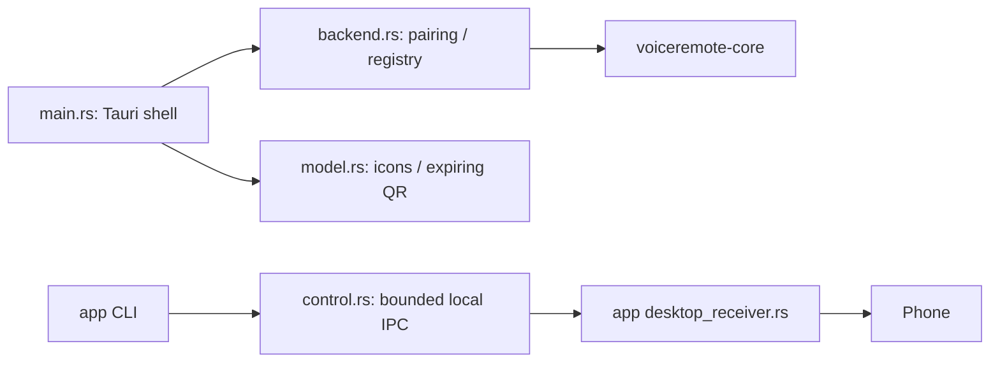

| File | Purpose | Status |
|---|---|---|
| [main.rs](main.rs) | Tray menu, hide-on-close, autostart, nonfocusable overlay | 🟡 native GUI unverified |
| [backend.rs](backend.rs) | Core pairing, dual confirmation, resumed receiver, persisted device/revoke tests, fixed event log | 🟡 core reuse; physical phone unverified |
| [control.rs](control.rs) | Fixed toggle request, Unix UID checks, Windows SID DACL; also compiled by app | ✅ Unix synthetic tests; Windows runtime unverified |
| [model.rs](model.rs) | QR expiry/rotation, short display reference, state icons | ✅ synthetic tests |
| [lib.rs](lib.rs) | Plain library; shares app transport/driver by path | ✅ no GUI dependencies by default |

Start at `Backend::open` and `pair_loop`. REQ-18/21–25/57. Wire contracts and
cryptography remain in core. Capture requests use the existing capture-state
record; phone interpretation and Auto pre-insertion announcements are unverified.

`backend.rs` owns dual-path pairing/resume and transient provisioning; `control.rs` correlates phone requests, presentation readiness and revocation notices. `main.rs` acknowledges only successful tray/overlay presentation calls. Stalled-presentation ordering has an encrypted session regression.
