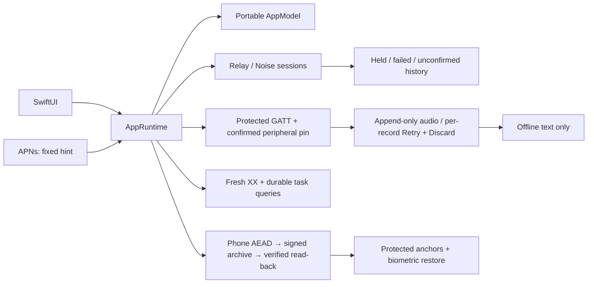

| Path | What | Status |
|---|---|---|
| [VoiceRemoteApp.swift](VoiceRemoteApp.swift) | Controls, cloud indicator, history Send/Copy/Share, approval | 🟡 Apple/device **unverified** |
| [UIDemo.swift](UIDemo.swift) | DEBUG-only synthetic capture/STT/Brain, pairing, transport and biometric adapters; real AppModel/Policy/router | ✅ Linux adapter probe; Apple UI **unverified** |
| [AppRuntime.swift](AppRuntime.swift) | Protected storage, signed cloud transports, deferred STT | 🟡 Apple/device **unverified** |
| [PhoneWakeDelegate.swift](PhoneWakeDelegate.swift), [Push.entitlements](Push.entitlements) | Signing-gated APNs registration, fixed-hint background handler, bounded/coalesced reconciliation and best-effort daily archive scheduler | 🟡 Apple/APNs **unverified** |
| [AuditArchiveRuntime.swift](AuditArchiveRuntime.swift) | Atomic protected key/anchor/pending state; loss health, biometric recovery into pinned new slots, preserved originals | 🟡 Keychain/Apple **unverified**; portable crypto/recovery tests |
| [ComputerLink.swift](ComputerLink.swift) | Relay pairing/resume, revocation, HTTP suspension, insertion failure correlation | ✅ Shared protocol checks; Apple adapter **unverified** |
| [RemoteBLELink.swift](RemoteBLELink.swift) | Numeric Comparison confirmation, persisted pin, protected reconnect, draft 1.1 sync and live preemption | 🟡 SDK/bonding/hardware **unverified** |
| [DevicesView.swift](DevicesView.swift), [QRScanner.swift](QRScanner.swift) | Pairing, enrollment, status, per-record Retry/Discard | 🟡 Apple/device **unverified** |
| [PhoneCapture.swift](PhoneCapture.swift) | Phone/AirPods source and interruption stop | 🟡 Device **unverified** |
| [SecureStore.swift](SecureStore.swift) | Device-local Keychain; separate relay and Noise identities | 🟡 Apple persistence **unverified** |
| [ListeningActivity.swift](ListeningActivity.swift) | Live Activity and Action Button | 🟡 Apple/device **unverified** |
| [Settings/](Settings/README.md) | Relay, model/version, speech/brain/vocabulary and benchmarks | 🟡 Apple/device **unverified** |

Start with AppRuntime and [portable tests](../Packages/AppModel/Tests/README.md).
Inputs: SYS relay-join/noise, desktop insertion reports, external BLE draft 1.1,
cross review. Evidence: package tests, [real relay gate](../../../SYS/tests/e2e/README.md),
Linux syntax/interface probes. Trace: REQ-2–12/16–18/22–25/28–33/38/46–52/56/60/61.

Remote enrollment: enter local pairing mode; select remote; compare the fresh
six-digit iPhone system/remote number and approve on both screens, then enter both
numbers in Devices and confirm. Protected GATT access and explicit confirmation
persist the peripheral/recording-namespace pin in device-local Keychain. Reconnect
restores that pin after protected access. Reject mismatch, no-number, Legacy and
Just Works pairing. **Gap:** CoreBluetooth cannot attest the method, inspect/remove
OS bonds, or cryptographically authenticate this service itself. Firmware must
enforce LE Secure Connections + MITM on every attribute. Numeric Comparison
interoperability is **unverified**. Forget removes the app pin and stops capture;
also forget the iPhone OS bond and erase the remote owner bond. The prototype
microphone-cut exception grants no authentication exception.

Relay 403 suspends routing/cloud access and retains credentials. Retry is explicit;
only user removal or authenticated Noise Revoke deletes trust. Cleanup attempts
self-revoke even after computer-revoke 403. Desktop failed TaskStatus uses
command_id = segment_id: unavailable means failed/not inserted; error means
unconfirmed. Success remains unconfirmed without a positive insertion ACK.

Held text splits safely and is journaled before wire encoding. Connection changes
prevent automatic later insertion; Send is explicit. Copy accepts offline IDs and
full text. Deferred audio uses protected append-only per-record files, deleted
after successful STT or explicit discard. Silent/oversized/failed records remain
visible without starving later records. Live PTT yields STT and resumes when idle;
ambiguous failures require Retry. Offline text never invokes Brain or inserts.

ComputerLink uses the shared production PhoneConnection for readiness, correlated insertion outcomes, state reports and read-only reconciliation. New connections try every discovered same-room private LAN candidate with pinned Noise, then signed relay. Browser timeout is not task cancellation. Authenticated remote capture is stop-only: microphone starts are refused with actual state, and sequence/deadline checks reject delayed requests. Keyboard delivery waits for a post-insertion shared receipt. Apple adapters/display timing remain **unverified**.

Privacy (REQ-56): one installation account is pinned in ThisDeviceOnly Keychain before stores open; Settings cannot switch accounts. Legacy files stay in place. History exposes expired held text as a required Settings review; Keep renews seven days, Delete removes it. `RetainedTaskStore` expires on-disk payloads/previews at seven days and keeps replay hashes; audit checkpoints and key metadata remain. Portable tests cover the rules; SwiftUI/Keychain execution remains **unverified**.
AI Control is wired through AppRuntime → AgentControl → Router → ComputerLink/PhoneConnection. Devices has explicit agent-access enrollment; Suggestions has exact session selection, status/cancel, restored-task review and scoped target-selection permission/revoke controls. Ambiguous wake never creates identity or tier 2 authority. Apple SDK/device verification remains **unverified**.

Rebase integration: AI Control shares the account-pinned `RetainedTaskStore`, original history expiry/review rules and audit/checkpoints; it does not open a separate raw task store.

Sleep/wake and archive (REQ-29/32/34–35/54–55/61): wake invalidates queued permits before fresh sessions query durable command identities. No wake payload becomes work; unknown/old sessions cannot execute. Archive uses AES-256-GCM with fresh nonces and authenticated v2 context, member-signed exact HTTP bytes, scheduled chain/tag read-back, and visible lost-copy/writer-refusal state. Recovery requires fresh Face ID/passcode, retains originals, retires the source slot, and resumes the same staged destination after a crash. Missing checkpoints/keys never silently create trust. Loss acceptance with a new authority remains unavailable because an executor fence is required.

Signed APNs opt-in: set `VOICE_REMOTE_APP_ENTITLEMENTS=App/Push.entitlements` and `VOICE_REMOTE_PUSH_ENVIRONMENT=development` (sandbox) or `production`, with the matching owner profile/APNs topic. Defaults keep the existing app-group entitlement and skip push registration. Tokens remain in memory and are re-requested each launch; registration is refreshed after pairing/reconnect. [Apple background notification rules](https://developer.apple.com/documentation/usernotifications/pushing-background-updates-to-your-app) govern delivery. BG refresh is best effort; foreground/reconnect also verify. Relay direct APNs transport and locked-device continuation remain **unverified**; see [relay limitations](../../relay/README.md).

Remote controls (REQ-4/8/18/49–53): both named boards use `RemoteBLECaptureSource`; authenticated PTT/mode/target edges drive the phone. Snapshot/reconnect never starts capture. HOLD qualifies by remote ticks (300 ms), with no tap-lock or remote approval; provisional PCM stays in a bounded buffer until qualified release. The 120 s defensive bound interrupts overflow. Status-only snapshots cannot invalidate an arming write; a changed physical control can. Source choice is explicit or uses recent PCM envelope/clipping/interruption estimates; proximity remains unknown and scoring is **TBC**. No mid-utterance fallback. Named board benchmark exports use a separate format because the shared bench schema excludes remotes; hardware throughput/first-word quality remain **unverified**.

| Cross-review boundary | Current behavior / evidence |
|---|---|
| Push socket | Registration uses the existing authenticated relay socket. No extra `/connect`; no paired-socket replacement or discarded queue drain. Reconnect submits retained routing metadata. |
| Scene / presentation | Reconcile after background only; Face ID and Control Center inactivity preserve sessions/approvals. Live Activity request failures do not interrupt BLE capture; local UI gesture cancellation does not stop remote HOLD. |
| Remote trigger / privacy | Automatic honors a fresh remote trigger without quality history. Source and remote generation pin before async setup; Home displays the active microphone. Mode flips restart REC only while already recording; target-cycle preserves release state. Unenrolled peripherals receive a constant handshake without destination labels; incompatible majors display incompatibility. |
| Acknowledgement | Arm acknowledgement lies between latest control event and latest Input, modulo u32. Status snapshots during held PTT do not invalidate arming. |
| Audit upgrades / membership | Empty unmarked legacy journals migrate without a prior checkpoint. Nonempty or marked missing-anchor history stays blocked for recovery/loss handling. No relay rooms means no verified-copy claim. |

Evidence: [cross-review tests](../Packages/AppModel/Tests/CrossReviewTests.swift) and [replacement-enforcing socket tests](../Packages/AppModel/Tests/SignedPhoneTransportTests.swift). Apple SDK/Keychain/physical BLE execution remains **unverified**.

AI Control now exposes automatic session priorities/defaults, configured fallback orders and a one-action independence choice. Exact changed routes require new approval. The owner completion sheet shows instruction/task/full provider route and explains that linked steps wait for “This finished”. AppRuntime binds local history/offline/audit construction to the protected installation account. Argmax remains visibly unavailable without a licensed loaded adapter. Portable flows are tested in AppModel; SwiftUI/LA/device execution **unverified** on Linux.

Provider-order editing keeps raw comma-separated drafts rather than rewriting text on every keystroke. Cloud approval previews explicitly say “Cloud fallback · new execution”. Portable draft/preview tests pass; Apple UI execution remains **unverified**.

Debug UI review: `--ui-demo` selects fresh temporary state and synthetic identities;
normal Debug launches use the existing runtime. Release ignores all `--ui-*`
arguments. [UITests](../UITests/README.md) documents the screenshot matrix and
permission/state fault flags; fakes do not grant authority or replace Policy.
The recorder marks demo runs synthetic. OS prompts, actual audit restoration and hardware remain
**unverified**. No synthetic data enters production identity/history storage.
