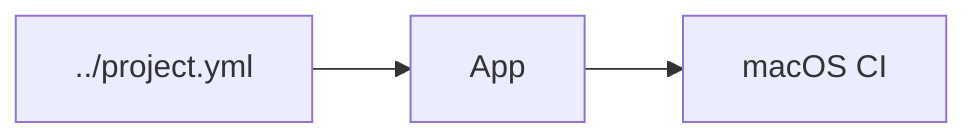

| File | What | Status |
|---|---|---|
| [VoiceRemoteApp.swift](VoiceRemoteApp.swift) | SwiftUI entry and setup placeholder; no capture or dispatch. | 🟡 macOS build unverified |

Start with the linked file; see the [iOS map](../README.md) for design and validation.
