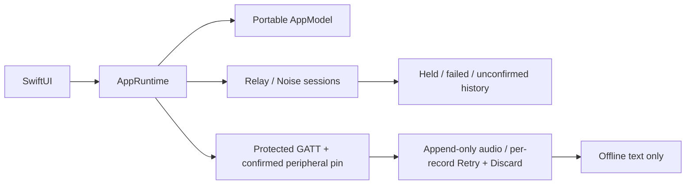

| Path | What | Status |
|---|---|---|
| [VoiceRemoteApp.swift](VoiceRemoteApp.swift) | Controls, cloud indicator, history Send/Copy/Share, approval | 🟡 Apple/device **unverified** |
| [AppRuntime.swift](AppRuntime.swift) | Protected storage, signed cloud transports, deferred STT | 🟡 Apple/device **unverified** |
| [ComputerLink.swift](ComputerLink.swift) | Relay pairing/resume, revocation, HTTP suspension, insertion failure correlation | ✅ Shared protocol checks; Apple adapter **unverified** |
| [RemoteBLELink.swift](RemoteBLELink.swift) | Numeric Comparison confirmation, persisted pin, protected reconnect, draft 1.1 sync and live preemption | 🟡 SDK/bonding/hardware **unverified** |
| [DevicesView.swift](DevicesView.swift), [QRScanner.swift](QRScanner.swift) | Pairing, enrollment, status, per-record Retry/Discard | 🟡 Apple/device **unverified** |
| [PhoneCapture.swift](PhoneCapture.swift) | Phone/AirPods source and interruption stop | 🟡 Device **unverified** |
| [SecureStore.swift](SecureStore.swift) | Device-local Keychain; separate relay and Noise identities | 🟡 Apple persistence **unverified** |
| [ListeningActivity.swift](ListeningActivity.swift) | Live Activity and Action Button | 🟡 Apple/device **unverified** |
| [Settings/](Settings/README.md) | Relay, model/version, speech/brain/vocabulary and benchmarks | 🟡 Apple/device **unverified** |

Start with AppRuntime and [portable tests](../Packages/AppModel/Tests/README.md).
Inputs: SYS relay-join/noise, desktop insertion reports, external BLE draft 1.1,
cross review. Evidence: package tests, [real relay gate](../../../SYS/tests/e2e/README.md),
Linux syntax/interface probes. Trace: REQ-2–12/16–18/22–25/28–33/38/46–52/56/60/61.

Remote enrollment: enter local pairing mode; select remote; compare the fresh
six-digit iPhone system/remote number and approve on both screens, then enter both
numbers in Devices and confirm. Protected GATT access and explicit confirmation
persist the peripheral/recording-namespace pin in device-local Keychain. Reconnect
restores that pin after protected access. Reject mismatch, no-number, Legacy and
Just Works pairing. **Gap:** CoreBluetooth cannot attest the method, inspect/remove
OS bonds, or cryptographically authenticate this service itself. Firmware must
enforce LE Secure Connections + MITM on every attribute. Numeric Comparison
interoperability is **unverified**. Forget removes the app pin and stops capture;
also forget the iPhone OS bond and erase the remote owner bond. The prototype
microphone-cut exception grants no authentication exception.

Relay 403 suspends routing/cloud access and retains credentials. Retry is explicit;
only user removal or authenticated Noise Revoke deletes trust. Cleanup attempts
self-revoke even after computer-revoke 403. Desktop failed TaskStatus uses
command_id = segment_id: unavailable means failed/not inserted; error means
unconfirmed. Success remains unconfirmed without a positive insertion ACK.

Held text splits safely and is journaled before wire encoding. Connection changes
prevent automatic later insertion; Send is explicit. Copy accepts offline IDs and
full text. Deferred audio uses protected append-only per-record files, deleted
after successful STT or explicit discard. Silent/oversized/failed records remain
visible without starving later records. Live PTT yields STT and resumes when idle;
ambiguous failures require Retry. Offline text never invokes Brain or inserts.

ComputerLink uses the shared production PhoneConnection for readiness, correlated insertion outcomes, state reports and read-only reconciliation. New connections prefer private LAN then signed relay. Keyboard delivery waits for a post-insertion shared receipt. Apple adapters/display timing remain **unverified**.
