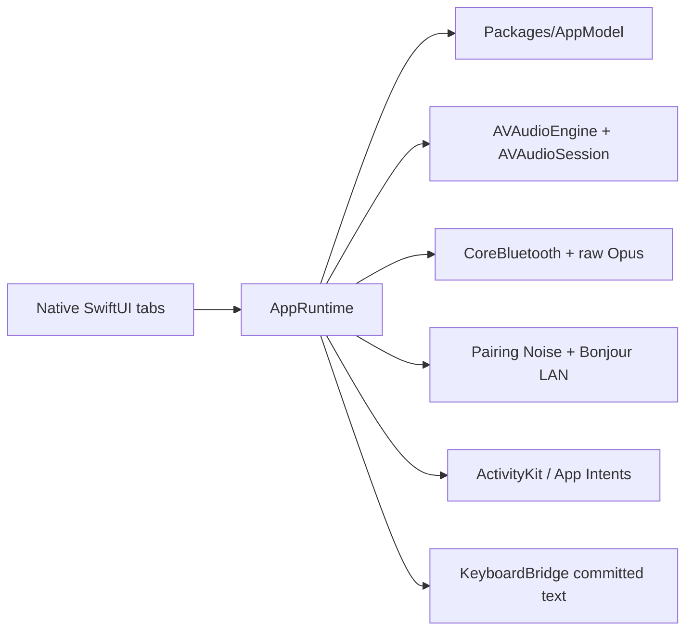

| Path | What | Status |
|---|---|---|
| [VoiceRemoteApp.swift](VoiceRemoteApp.swift) | Home controls, target picker, text history, suggestions, exact-action approval | 🟡 Apple compile/device **unverified** |
| [AppRuntime.swift](AppRuntime.swift) | Merged package composition, explicit model provisioning, protected storage, keyboard producer | 🟡 Apple compile/device **unverified** |
| [PhoneCapture.swift](PhoneCapture.swift) | AirPods HFP/phone capture, PCM16 resampling, route/interruption stop; no files | 🟡 Apple compile/routes **unverified** |
| [ComputerLink.swift](ComputerLink.swift) | Small Pairing adapter, Bonjour LAN, Noise framing, phrase/revoke/insertion | 🟡 Interoperability, fresh pinned session resumption, short code and relay **unverified** |
| [DevicesView.swift](DevicesView.swift), [QRScanner.swift](QRScanner.swift) | QR/fallback, roles, four-word confirmation and remote chooser | 🟡 Camera/accessibility/device **unverified** |
| [RemoteBLELink.swift](RemoteBLELink.swift) | Draft GATT, display-write barrier, Opus decode, watchdog and loss stop | 🟡 Authenticated enrollment missing; capture disabled; hardware **unverified** |
| [SecureStore.swift](SecureStore.swift) | ThisDeviceOnly Keychain identity/checkpoints, no vendor keys | 🟡 Device persistence/recovery **unverified** |
| [ListeningActivity.swift](ListeningActivity.swift) | Recording activity and Action Button AudioRecordingIntent | 🟡 Locked/unlocked/cold-start **unverified** |
| [Settings/](Settings/README.md) | Speech/brain/vocabulary/relay and benchmark share UI | 🟡 Apple compile/device **unverified** |

Start with AppRuntime; [AppModel](../Packages/AppModel/README.md) owns tested decisions.
Purpose: task 6 Apple adapters and native views. Inputs: SYS design/product/requirements,
merged package protocols, SW/bench and draft BLE contract. Verification: Swift syntax
parse only; SDK type checking/real-device behavior **unverified**. REQ-2–8/12/16–18/22–25/28–33/38/46–52/56.
Native Form/List/Picker/Sheet/Button/Share controls follow Dynamic Type, system appearance
and VoiceOver; large text, dark mode and complete VoiceOver navigation need owner checks.

Audio options checked 2026-11-02: Apple's [HFP input option](https://developer.apple.com/documentation/avfaudio/avaudiosession/categoryoptions-swift.struct/allowbluetoothhfp),
[A2DP output option](https://developer.apple.com/documentation/avfaudio/avaudiosession/categoryoptions-swift.struct/allowbluetootha2dp),
and [AudioRecordingIntent activity requirement](https://developer.apple.com/documentation/appintents/audiorecordingintent).
HFP supplies input; A2DP alone cannot. A connected computer changes text routing, never audio routing.
Opus is an unmodified pinned SwiftPM dependency [alta/swift-opus 0.0.2](https://github.com/alta/swift-opus/tree/0.0.2),
using its Copus library; [upstream licensing](https://github.com/alta/swift-opus/blob/0.0.2/LICENSE) remains upstream.
No third-party source is copied. Coordinator must review dependency licensing for release.

Cross-review follow-up: views bind child observable references locally. GestureState
reset and foreground exit cancel HOLD; audio callbacks are explicitly Sendable and
created outside MainActor. Audio observers install after start, category changes are
ignored, and engine format changes rebuild the tap on the same sample timeline.
Peers restore from protected metadata plus Keychain keys; desktop Revoke is attempted
before closing, and notification failures remain visible. Cold intent and scene share
one runtime bootstrap. BLE uses current app presentation, awaited write barriers and a
conservative 20-byte value budget, avoiding ATT long writes. The final SYS BLE document
is absent on this base; the supplied draft remains the input. All Apple execution is
**unverified**, pending the coordinator's CI and owner route/gesture checks.

Apple references checked for this correction: [route reasons](https://developer.apple.com/documentation/avfaudio/avaudiosession/routechangereason),
[gesture reset](https://developer.apple.com/documentation/swiftui/gesturestate),
[engine reconfiguration](https://developer.apple.com/documentation/avfaudio/avaudioengineconfigurationchangenotification),
[long-write distinction](https://developer.apple.com/documentation/corebluetooth/cbcharacteristicwritetype).

Swift 6 audit: ActivityKit handles stay inside nonisolated operations; only IDs and
strings enter the ordered update/end queue. Bluetooth delegates run synchronously
on their configured main queue, without transferring SDK objects in Tasks. QR
configuration/start/stop share one serial owner; permission, network, audio and
share callbacks explicitly use Sendable closures. First BLE state write waits for
subscriptions and requests a snapshot even if reconnect's initial notification was
missed. Portable reconnect regression was reproduced failing first; Apple SDK build
and device execution remain **unverified** pending CI.
API references: [Activity lookup](https://developer.apple.com/documentation/activitykit/activity/activities),
[async updates](https://developer.apple.com/documentation/activitykit/activity/update(_:alertconfiguration:)),
[Bluetooth delegate queue](https://developer.apple.com/documentation/corebluetooth/cbcentralmanager/init(delegate:queue:)),
[serial camera session](https://developer.apple.com/documentation/avfoundation/avcapturesession).
