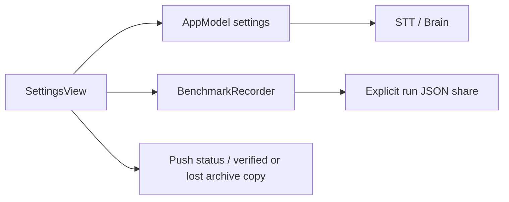

| File | What | Status |
|---|---|---|
| [SettingsView.swift](SettingsView.swift) | Native engine/brain/vocabulary settings, relay origin and deployment model/API version; model preparation; recorder and share completion | 🟡 Apple compile/device **unverified** |
| Sleep / audit section | Registration, archive loss/writer status and explicit read-back verification; recovery is available at blocked startup | 🟡 Apple/device **unverified**; portable integrity tests |
| [EnginePickerView.swift](EnginePickerView.swift) | Previous standalone task 7 debug picker; retained for upstream package link compatibility | 🟡 Superseded by SettingsView in app navigation |

Start with SettingsView. Purpose: task 6 settings/benchmark UI; inputs: Stt/Brain contracts and
SW/bench schema/sets; verification: syntax parse only. REQ-9–14/37/56; accuracy/battery/latency **unverified**.

Cross-review: local Bindable references avoid writable key paths through runtime lets.
Settings changes persist immediately to a protected private file; consent withdrawal
also stops active capture. Apple compilation remains **unverified**.
Share completion is explicitly Sendable and sends only a success Bool to MainActor;
UIKit callback arguments remain inside the callback. SDK compilation **unverified**.

Cloud URLs are derived from retained relay membership. Relay origin edits apply to new pairing; existing computers retain the paired origin. Settings decode older files with defaults for the new model/version fields.

Recorder additions ([REQ-13], [REQ-15], [REQ-39]): listen to the last private capture and annotate clipping; enter an independently measured single-engine battery cohort; optionally attach correlated monotonic delivery/field offsets. Import `SW/bench/sets/commands.json` through Files before recording for a 50-command run, then export proposal-only Apple Foundation Models results plus A/B speech results. Actual microphone/SDK/UI execution is **unverified**. Argmax appears only after a licensed kit is registered and loaded.

After a successful share, start a new cohort for another microphone or command set; source/engine/vocabulary changes never mix into the prior export.

Privacy/consent: Settings shows the fixed installation account, participant/cloud policy and full expired held text with explicit Keep for seven days / Delete choices (REQ-56/58). Cloud consent remains off by default and is saved synchronously. Owner review of provider wording and Apple UI behavior remains **unverified**.

Named BLE sources export `voiceremote-named-source-benchmark-v1` with the board name and quality estimates; the comparison omits the shared schema's phone-only source label. Choose Remote in Devices and use REC or a fresh qualified HOLD before starting the recorder. Mixed named sources require a new cohort. Source scoring, first-word loss and board performance remain **unverified** (REQ-13/15/51/53).

Active Settings shows Argmax unavailable until a licensed host adapter is loaded, and persists local/cloud provider fallback orders. Suggestions owns selected/default sessions, per-action cloud independence and exact-route reapproval. Apple UI execution remains **unverified**.
